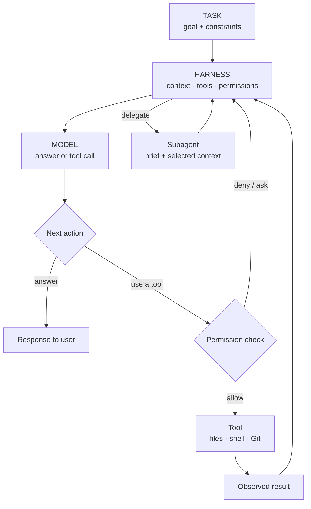
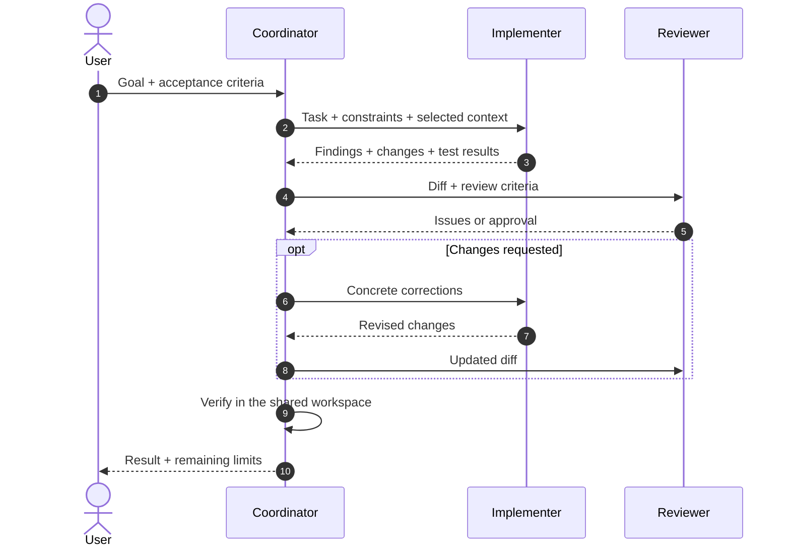

A coding agent is a system around a model. The harness supplies context and tools, enforces permissions, runs actions and decides what happens next.

<!--truncate-->

| **74** products catalogued | **40** public repositories checked for languages | **41** GitHub star snapshots |
| --- | --- | --- |
| **0** controlled experiments run for this article | Snapshot: 25 Oct 2026 | Stars indicate interest, not quality |

## The agent loop

*Conceptual flow: products differ in which steps they implement and expose.*

## What shapes behaviour?

| Layer | What it contributes | What to inspect |
| --- | --- | --- |
| **Model** | Coding ability, tool-call behaviour and supported context | Model version, API format, task conditions |
| **System prompt** | Role, priorities, workflow and constraints | Official source, exact version and runtime additions |
| **Harness** | Tools, permission gates, retries, session state and delegation | Tool loop, policy code and error handling |
| **Context + environment** | Project instructions, files, history, tests and access | What the agent actually received and could change |

These layers interact; this study does not assign them percentages. Public prompt fragments are not necessarily the complete effective prompt: modes, tool descriptions and project rules may be added at runtime. If a prompt sample has no verifiable source, the catalog does not reconstruct it.

## Delegation: who sends what to whom?

*This is a comparison model, not a transcript attributed to every product. Some workers share a workspace; others return messages or patches. The orchestrator must still check the result.*

A useful hand-off carries **the goal, boundaries, relevant context and acceptance checks**. A useful return carries **findings, changed files and verification evidence**. Too little context causes drift; too much can bury the task.

## Three protocols, three jobs

| Protocol | Connects | Does not establish |
| --- | --- | --- |
| **A2A** | Agents through discovery and task/message exchange | Native support in a coding product |
| **ACP** | An editor and a coding agent | Agent-to-agent delegation |
| **MCP** | An agent host and tools or data | Agent-to-agent communication |

The reviewed Gemini CLI documentation configures remote agents through A2A Agent Cards. That verifies a native A2A client path; it does not show that Gemini CLI serves an A2A endpoint. A community bridge or an A2A CLI invoked as a tool is an integration around a product, not proof of native support.

## What the snapshot can say

GitHub's Languages endpoint reports bytes by detected language, not the full runtime or the language shipped to users. Star counts change and are not a quality measure. Artifact sizes are comparable only when version, platform, architecture and package format match.

No controlled benchmark was run. The evidence supports a system-level view, not a performance ranking or a percentage split between model, prompt and harness. “Unverified” means no supporting source was confirmed in this pass; it does not mean “unsupported.”

## Sources

- [Gemini CLI remote agents](https://github.com/google-gemini/gemini-cli/blob/main/docs/core/remote-agents.md)
- [A2A specification](https://github.com/a2aproject/A2A/blob/main/docs/specification.md) · [A2A concepts](https://github.com/a2aproject/A2A/blob/main/docs/index.md)
- [GitHub Languages API](https://docs.github.com/en/rest/repos/repos#list-repository-languages)
- [ACP introduction](https://agentclientprotocol.com/get-started/introduction) · [MCP introduction](https://modelcontextprotocol.io/introduction)
- [Official A2A CLI](https://github.com/a2aproject/a2a-cli)
