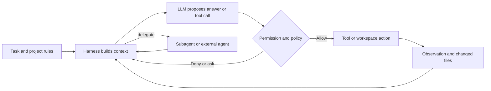

When a coding agent changes a repository, the language model is only one part of the system. The harness chooses what context to send, which tools to expose, how to run them, what to do with failures and when to stop. Prompts matter, but they do not grant filesystem access or execute a shell command by themselves.

I have been mapping those parts across 74 coding agents and adjacent products. This is a source-led snapshot, not a product ranking: closed systems are harder to inspect, and an undocumented capability remains unverified.

<!--truncate-->

## The model is not the agent

A useful mental model is a loop. The model proposes text or a structured tool call; the harness checks permissions, executes an action and returns the result as new context. The next model response depends on that feedback as well as the original prompt.

This is why a prompt comparison must hold the model and tools constant, while a harness comparison must hold the model, task and environment constant. Without those controls, “the agent did better” does not tell us which layer caused the difference.

## Prompts: evidence before quotation

Public source code and documentation expose useful prompt fragments for some tools. They do not always expose the complete effective prompt. A template may have variables, mode-specific instructions, tool descriptions and project rules appended at runtime. An example supplied by a user is not the vendor's default prompt.

The catalog therefore attaches a provenance label and source to each prompt sample. Where no verifiable excerpt was found, it says so instead of reconstructing one. This matters especially for closed products such as Cursor, Devin and Windsurf: leaked or community-collected text is not automatically an official prompt.

## Subagents and communication

Delegation is a runtime feature. A controller packages a brief and selected context, starts or addresses a worker, then decides how to receive and review its result. Some systems return a report; others share tasks, messages or a workspace. Fresh context can reduce noise, while omitted interfaces or constraints can make a worker solve the wrong problem.

The comparison keeps three protocols separate:

| Mechanism | Connection it standardizes | What it does not prove |
| --- | --- | --- |
| A2A | Agent to agent, with discovery and task/message exchange | That a coding product implements A2A natively |
| ACP | Editor to coding agent | That the agent can coordinate with another agent |
| MCP | Agent host to tools and data | Agent-to-agent communication |

In the official Gemini CLI documentation reviewed for this snapshot, remote agents are configured through A2A Agent Cards. That confirms a native A2A client path; it does not establish that Gemini CLI serves its own A2A endpoint. The rest of the 74-row matrix distinguishes documented internal delegation from A2A and labels unchecked cases as unverified. The A2A specification itself does not prescribe how an agent should talk to its subagents.

An agent can also call the official A2A CLI as a tool, or be wrapped by a community bridge. Those routes can connect otherwise incompatible systems, but they are integrations around the product, not evidence that the product implements A2A itself.

## What GitHub tells us about implementation

For 40 public or archived repositories linked from the catalog, I queried GitHub's Languages endpoint on 25 October 2026. It reports byte counts by detected language for a repository; the table shows the leading languages. It does not describe every runtime dependency or prove which languages ship in the end-user application.

The snapshot shows a varied implementation landscape: Rust is prominent in Codex, Goose, Zed and several CLI tools; TypeScript appears across many editor and terminal products; Python is common in research harnesses and SDKs. These observations describe the repositories. They do not establish why maintainers chose a language. That rationale remains pending until a primary source says so.

I also recorded GitHub star counts for 41 linked repositories on the same date. Stars are a changing popularity signal, not a quality metric, and some catalog entries have no linked agent repository. The Seed repository is an ecosystem/model source, not a coding-agent harness, so it is identified separately.

Artifact sizes need the same care. A compressed Linux archive, an unpacked npm package and a standalone executable measure different things. The catalog records version, platform, architecture and format when an asset size is available; it does not turn those values into a universal “agent size” ranking.

## What the evidence does and does not answer

This first audit supports a practical conclusion: behavior is jointly produced by model, prompt, harness, context, tools and environment. It does not assign a percentage to each layer. Public prompts are incomplete, many commercial runtimes are opaque, and unverified means “not established in this pass,” not “unsupported.”

No controlled benchmark has been run for this article. A fair experiment would vary one factor at a time: same model with different prompts, same model and prompt across harnesses, same harness with different models, and delegation or skills enabled versus disabled. It would record solved tasks, regressions, tool calls, delegated work, tokens, latency and cost, then use independent tests to judge the patch.

The next step is to finish source verification for the remaining A2A and technology rows, pin repository commits for reproducible snapshots and run controlled tasks before making performance claims.

## Sources

- [A2A specification](https://github.com/a2aproject/A2A/blob/main/docs/specification.md) and [A2A concepts](https://github.com/a2aproject/A2A/blob/main/docs/index.md)
- [Gemini CLI remote agents](https://github.com/google-gemini/gemini-cli/blob/main/docs/core/remote-agents.md)
- [GitHub Languages API](https://docs.github.com/en/rest/repos/repos#list-repository-languages)
- [Official A2A CLI](https://github.com/a2aproject/a2a-cli)
- [ACP introduction](https://agentclientprotocol.com/get-started/introduction) · [MCP introduction](https://modelcontextprotocol.io/introduction)

