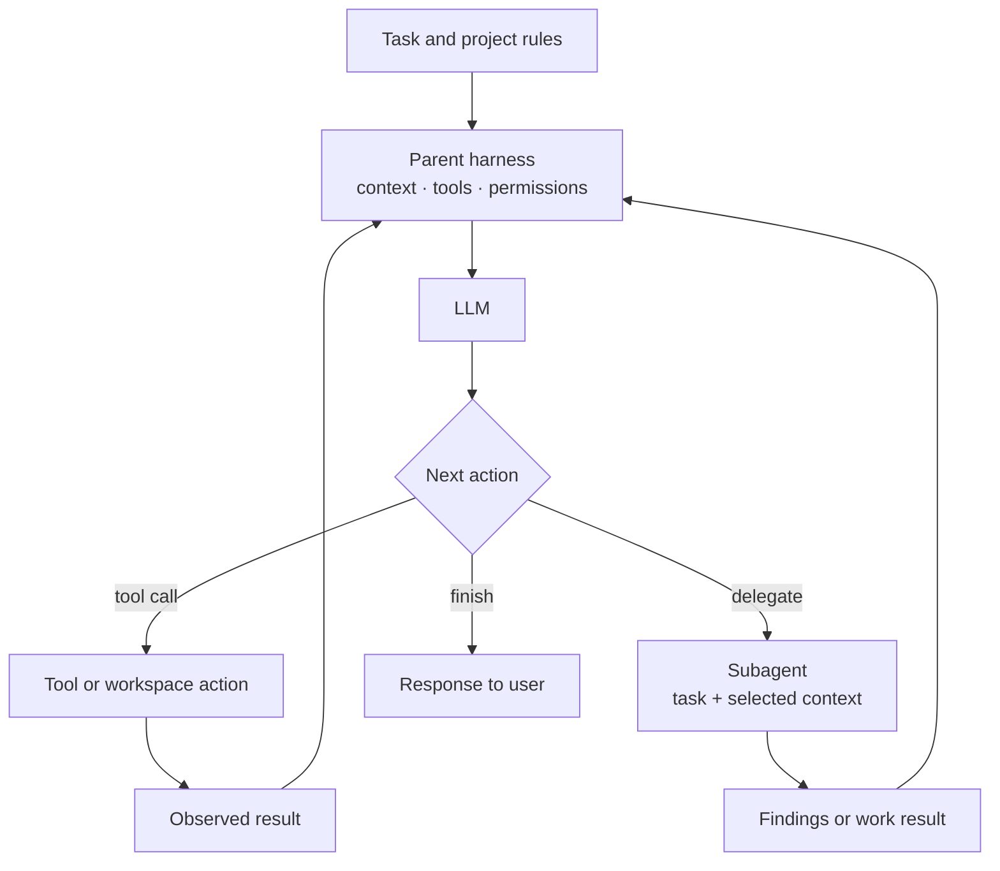
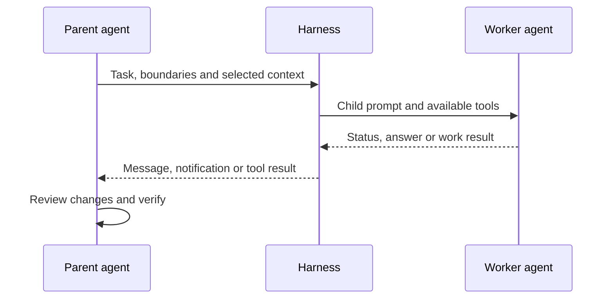

When a coding agent delegates work, what does the worker actually receive? Does it inherit the conversation, get a fresh task brief, or communicate through a protocol shared with other products?

That question is the focus of the first deep review in this study. We began with an inventory of 74 coding-agent and adjacent-product entries; coverage varies, so that number is a map of candidates, not 74 equally audited agents. This first code review covers five repositories: Codex CLI, Gemini CLI, OpenCode, Crush and Qwen Code.

**Research snapshot:** five pinned source commits · zero agent runs · zero benchmark results.

<!--truncate-->

## An agent is a runtime around a model

The LLM does not independently read a repository or run its tests. The harness selects context and tools, checks permissions, executes tool calls, and returns observations to the model. Delegation adds another context transfer and another result that the parent must evaluate.

The diagram describes a useful comparison model. Each repository implements different details, and the diagram is not a trace of a benchmark run.

The delegation question is narrower: the parent chooses what to send, the runtime starts the child, and the parent still owns review and verification.

*Comparison sketch only: each harness packages and returns work differently.*

## Five implementations, five hand-offs

| Agent | What the reviewed code shows | Communication boundary |
|---|---|---|
| **Codex CLI** | Spawns child threads and prepares forked history. The control layer exposes internal agent messages, listing and interruption. ([spawn](https://github.com/openai/codex/blob/970111f6cb62cc02fe36a82ea7d71b37a2889c97/codex-rs/core/src/agent/control/spawn.rs), [control](https://github.com/openai/codex/blob/970111f6cb62cc02fe36a82ea7d71b37a2889c97/codex-rs/core/src/agent/control.rs)) | Internal runtime coordination; this is not evidence of an A2A endpoint. |
| **Gemini CLI** | Its Agent tool asks the parent to provide a complete, detailed brief. Local and remote invocation paths are separate; the remote session path tracks A2A `contextId` and `taskId`. ([tool](https://github.com/google-gemini/gemini-cli/blob/cd1b45c2db0a5ea7b7fc3b67c1ba5879601d6005/packages/core/src/agents/agent-tool.ts), [remote session](https://github.com/google-gemini/gemini-cli/blob/cd1b45c2db0a5ea7b7fc3b67c1ba5879601d6005/packages/core/src/agents/remote-session-invocation.ts)) | A2A client path verified in this snapshot; a conformant server was not verified here. |
| **OpenCode** | Creates a child session, supports background execution and returns a completion notification/result to the parent. ([subagent tool](https://github.com/anomalyco/opencode/blob/450e7b92412c780a7b5a75226bb8d49aaca24e22/packages/core/src/tool/plugin/subagent.ts), [completion](https://github.com/anomalyco/opencode/blob/450e7b92412c780a7b5a75226bb8d49aaca24e22/packages/core/src/session/subagent-completion.ts)) | Product-specific sessions and hand-off; no A2A implementation located in the reviewed paths. |
| **Crush** | Builds a task agent and runs it through a parallel agent tool. The call requires session and message identifiers from the runtime. ([agent tool](https://github.com/charmbracelet/crush/blob/9ab41e330eb47057a328ba2aeba3c702522a43eb/internal/agent/agent_tool.go)) | Parallel local delegation; no A2A implementation located in the reviewed paths. |
| **Qwen Code** | Provides task subagents and an explicit conversation fork. The reviewed code also implements an external A2A 1.0 JSON-RPC server, guarded by the experimental `agentCollaboration` setting, which defaults off. ([agent tool](https://github.com/QwenLM/qwen-code/blob/41ce46af24c0bda9441216191a4b119fef846fab/packages/core/src/tools/agent/agent.ts), [A2A contract](https://github.com/QwenLM/qwen-code/blob/41ce46af24c0bda9441216191a4b119fef846fab/packages/core/src/agents/workspace-agents/a2a-contract.ts), [configuration](https://github.com/QwenLM/qwen-code/blob/41ce46af24c0bda9441216191a4b119fef846fab/packages/cli/src/config/config.ts)) | The endpoint is opt-in. An external caller cannot approve a local tool action on behalf of the workspace owner. |

This is evidence of implementation in those exact commits, not proof that every path is enabled in every release or that the products interoperate successfully. Internal delegation and A2A are different layers.

## The prompts are not all the same kind of evidence

The source review also found short, verifiable prompt artifacts. These excerpts are not complete effective prompts: the runtime can add tool instructions, project rules, mode-specific text and conversation context.

| Agent | Literal excerpt | Artifact type |
|---|---|---|
| Codex CLI | “You are a coding agent running in the Codex CLI…” ([source](https://github.com/openai/codex/blob/970111f6cb62cc02fe36a82ea7d71b37a2889c97/codex-rs/models-manager/prompt.md)) | Published system prompt |
| Gemini CLI | “The COMPLETE query to send the subagent. MUST be comprehensive and detailed.” ([source](https://github.com/google-gemini/gemini-cli/blob/cd1b45c2db0a5ea7b7fc3b67c1ba5879601d6005/packages/core/src/agents/agent-tool.ts)) | Agent tool schema, not the main system prompt |
| OpenCode | “You are an AI agent running in OpenCode, a coding agent harness.” ([source](https://github.com/anomalyco/opencode/blob/450e7b92412c780a7b5a75226bb8d49aaca24e22/packages/core/src/session/runner/prompt/system.txt)) | Shared prompt template |
| Crush | “You are Crush, a powerful AI Assistant that runs in the CLI.” ([source](https://github.com/charmbracelet/crush/blob/9ab41e330eb47057a328ba2aeba3c702522a43eb/internal/agent/templates/coder.md.tpl)) | Coder-role template |
| Qwen Code | `You are Qwen Code, ${role} developed by Alibaba Group…` ([source](https://github.com/QwenLM/qwen-code/blob/41ce46af24c0bda9441216191a4b119fef846fab/packages/core/src/core/prompts.ts)) | Dynamic identity template |

The distinction matters: a subagent instruction, a role template and a complete system prompt are not interchangeable samples.

## What we can say so far

In this first group, delegation is not one shared feature with a common hand-off format. The products differ in what conversation a child inherits, how the task is packaged, whether work runs in the background, and how progress or results return. A2A support must be reported separately from these internal mechanisms.

The early conclusion is that coding agents are fragmented by default at the orchestration layer. That does not mean they cannot be connected: adapters and external protocols exist. It means that interoperability should be demonstrated pair by pair rather than inferred from the word “agent”.

## What remains unknown

We inspected source code but did not run these agents, test cross-product A2A, or compare outputs. The review has not yet traced every tool loop, retry, permission boundary or context limit. We have no measured answer to how much behavior comes from the model, prompt or harness; answering that requires controlled experiments with those variables held constant.

The next reviews will deepen this source audit before any performance claims are made. The [study site](https://valdepeace.github.io/agentscope/) and [repository](https://github.com/valdepeace/agentscope) hold the wider inventory, source ledger and uncertainty notes.
