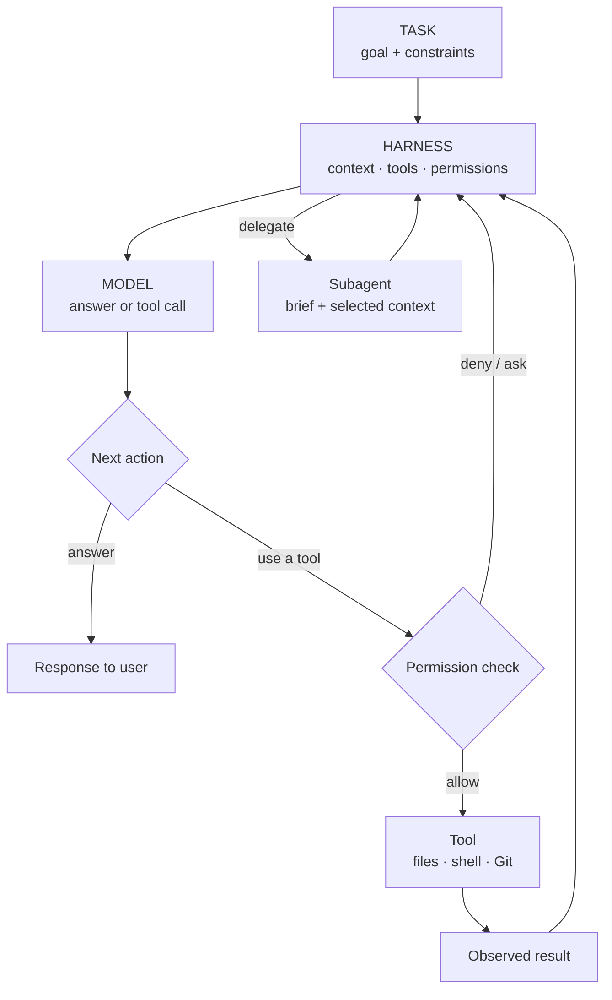
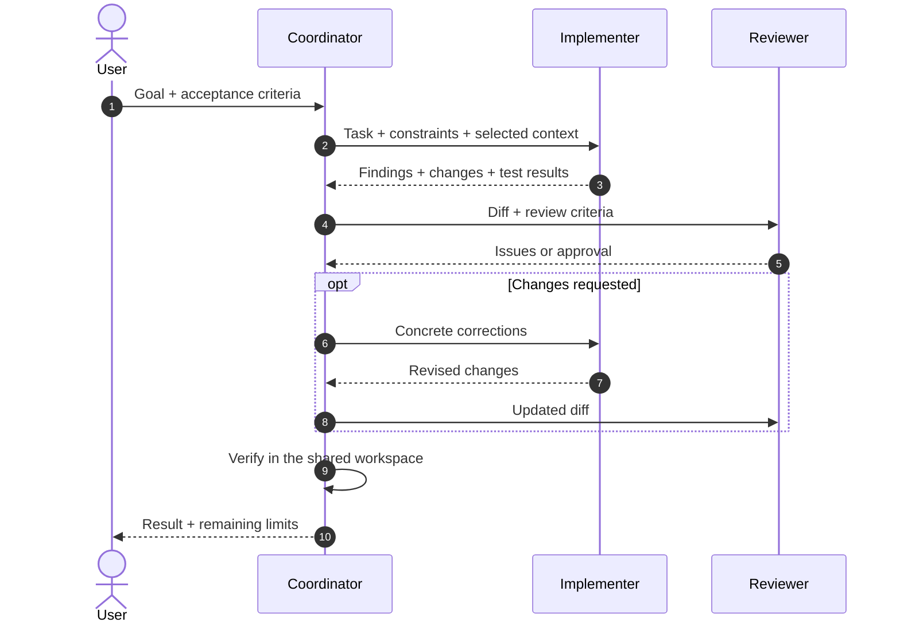

A coding agent is a system around a model. The harness supplies context and tools, enforces permissions, runs actions and decides what happens next.

**Study and source files:** [interactive AgentScope study](https://valdepeace.github.io/agentscope/) · [GitHub repository](https://github.com/valdepeace/agentscope).

<!--truncate-->

| **74** products catalogued | **40** public repositories checked for languages |
| --- | --- |
| **41** GitHub star snapshots · 25 Oct 2026 | **0** controlled experiments run for this article |

*Stars indicate interest, not quality.*

## The agent loop

*Conceptual flow: products differ in which steps they implement and expose.*

## What shapes behaviour?

| Layer | Contribution and evidence to inspect |
| --- | --- |
| **Model** | Coding and tool-call ability; check model version, API format and task conditions. |
| **System prompt** | Role, priorities and constraints; check the official source and runtime additions. |
| **Harness** | Tools, permissions, retries, sessions and delegation; inspect the loop and policy code. |
| **Context + environment** | Project rules, files, history, tests and access; check what the agent actually received. |

These layers interact; this study does not assign them percentages. Public prompt fragments are not necessarily the complete effective prompt: modes, tool descriptions and project rules may be added at runtime. If a prompt sample has no verifiable source, the catalog does not reconstruct it.

## Delegation: who sends what to whom?

*This is a comparison model, not a transcript attributed to every product. Some workers share a workspace; others return messages or patches. The orchestrator must still check the result.*

A useful hand-off carries **the goal, boundaries, relevant context and acceptance checks**. A useful return carries **findings, changed files and verification evidence**. Too little context causes drift; too much can bury the task.

## Three protocols, three jobs

| Protocol | Boundary |
| --- | --- |
| **A2A** | Agent discovery and task/message exchange; a product may still lack native support. |
| **ACP** | Editor ↔ coding agent; this alone does not mean agent delegation. |
| **MCP** | Agent host ↔ tools/data; it is not agent-to-agent communication. |

Two official CLIs have A2A paths in the sources reviewed:

| CLI | Evidence-backed path | Boundary |
| --- | --- | --- |
| **Gemini CLI** | Connects to remote agents through A2A Agent Cards. | Client support does not prove it serves its own A2A endpoint. |
| **Qwen Code** | Official notes announce cross-CLI collaboration; its design marks A2A on sessions implemented behind `experimental.agentCollaboration` (off by default). | Qwen coordinates the session; this does not make Claude Code or Codex standalone native A2A peers. |

Qwen's documented adapters can run Qwen Code, Claude Code or Codex locally, or through a remote Qwen host. The coordinator carries the collaboration flow; verify the feature flag and version before treating it as available. [Design note](https://github.com/QwenLM/qwen-code/blob/main/docs/design/2026-10-05-session-multi-agent.md) · [Qwen release update](https://qwenlm.github.io/qwen-code-docs/en/blog/updates/weekly-update-2026-10-15/)

An A2A CLI invoked as a tool or a community bridge can connect other products, but that is an integration around them—not proof of native support.

## What the snapshot can say

GitHub's Languages endpoint reports bytes by detected language, not the full runtime or the language shipped to users. Star counts change and are not a quality measure. Artifact sizes are comparable only when version, platform, architecture and package format match.

No controlled benchmark was run. The evidence supports a system-level view, not a performance ranking or a percentage split between model, prompt and harness. “Unverified” means no supporting source was confirmed in this pass; it does not mean “unsupported.”

## Conclusion: fragmented by default

| Evidence from this snapshot | Supported reading | Limit |
| --- | --- | --- |
| 74 products catalogued | The review finds no shared default for delegation, context, permissions and result hand-off. | The source matrix is incomplete. |
| Gemini CLI and Qwen Code | Official A2A paths are documented in both projects. | Qwen's path is opt-in; adapters do not make Claude Code or Codex native A2A clients. |
| ACP and MCP | They connect editors to agents, and agents to tools/data. | Neither is a substitute for A2A. |

“Each is doing its own thing” is a fair shorthand for the current default: product-specific orchestration with selective bridges. It is not evidence of total isolation. This is a qualitative reading of the reviewed sources, not a count of every implementation or a benchmark of interoperability.

## Sources

- [Gemini CLI remote agents](https://github.com/google-gemini/gemini-cli/blob/main/docs/core/remote-agents.md)
- [Qwen Code session multi-agent design](https://github.com/QwenLM/qwen-code/blob/main/docs/design/2026-10-05-session-multi-agent.md) · [Qwen release update](https://qwenlm.github.io/qwen-code-docs/en/blog/updates/weekly-update-2026-10-15/)
- [A2A specification](https://github.com/a2aproject/A2A/blob/main/docs/specification.md) · [A2A concepts](https://github.com/a2aproject/A2A/blob/main/docs/index.md)
- [GitHub Languages API](https://docs.github.com/en/rest/repos/repos#list-repository-languages)
- [ACP introduction](https://agentclientprotocol.com/get-started/introduction) · [MCP introduction](https://modelcontextprotocol.io/introduction)
- [Official A2A CLI](https://github.com/a2aproject/a2a-cli)
