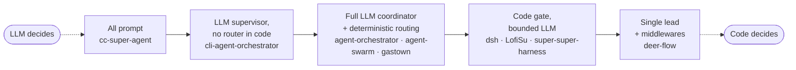
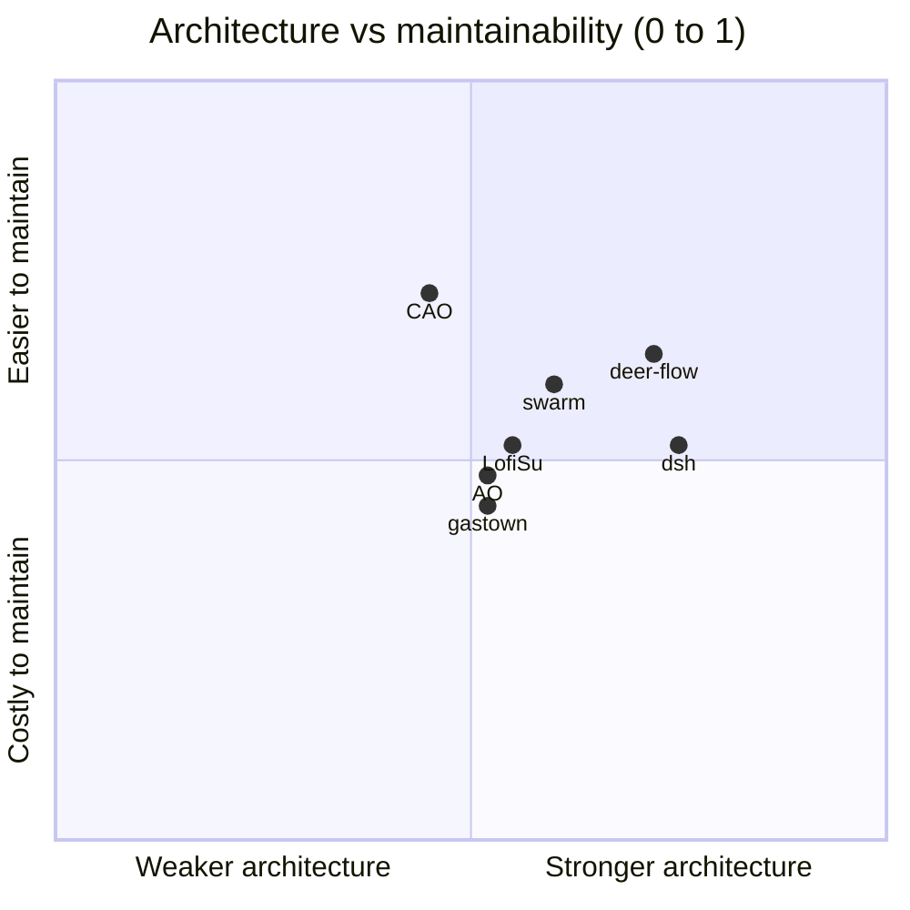

Which part of an agent orchestrator should be an LLM, and which part should be plain code?

I read nine open-source orchestrators to find out. This post is the overview; the long version has file-and-line citations.

**Research snapshot:** nine repositories · source reading only · nothing executed · 807 file:line citations re-checked, 72 sampled (none contradicted) · reading coverage between 0.2 % and 32 % per repo.

<!--truncate-->

## The nine at a glance

| Repo | Origin | Stars | Language | Last push |
|---|---|---:|---|---|
| [deer-flow](https://github.com/bytedance/deer-flow) | ByteDance | 85,571 | Python + Next.js | 2026-11-21 |
| [gastown](https://github.com/gastownhall/gastown) | Organization, one main author | 18,862 | Go | 2026-11-14 |
| [agent-orchestrator](https://github.com/OrchestratorInc/agent-orchestrator) | Organization, commercial product | 14,996 | Go + Electron | 2026-11-21 |
| [dsh-superagent-prototype](https://github.com/deepseek-ai/dsh-superagent-prototype) | DeepSeek, official prototype | 24,127 | TypeScript | 2026-11-03 |
| [cli-agent-orchestrator](https://github.com/awslabs/cli-agent-orchestrator) | AWS Labs | 1,619 | Python | 2026-11-21 |
| [agent-swarm](https://github.com/desplega-ai/agent-swarm) | Organization | 1,097 | Bun / TypeScript | 2026-11-21 |
| [dsh-super-agent](https://github.com/LofiSu/dsh-super-agent) | Independent author | 146 | TypeScript | 2026-11-21 |
| [cc-super-agent](https://github.com/yingpengma/cc-super-agent) | Independent author | 7 | Bash + JS | 2026-11-02 |
| [super-super-harness](https://github.com/ketchupz1999/super-super-harness) | Independent author | 1 | Python | 2026-11-04 |

*GitHub data from 2026-11-21. DeepSeek's own prototype has about 24k stars and a single commit: that is brand pull, not usage.*

## One axis explains most of the difference: who decides

More logic in code makes behaviour easier to **verify**. Nothing in the nine shows that it gives **better results**: that is still unmeasured.

## Three ladders

| Repo | Worker isolation | Stuck-worker detection | Result acceptance |
|---|---|---|---|
| cc-super-agent | none | LLM on a cron, warns only | self-report |
| dsh-superagent-prototype | none | none | self-report |
| super-super-harness | none | code, with action | self-report |
| LofiSu | OS sandbox (macOS/Linux) | code, with action | self-report |
| agent-orchestrator | git worktree | only checks the process is alive | derived from PR/CI facts |
| gastown | git worktree | daemon on one agent; the rest is LLM agents | self-report |
| agent-swarm | Docker, opt-in, open network | code classifier | self-report |
| cli-agent-orchestrator | disposable pods (example only) | regex on the TUI screen | self-report ("false victory") |
| deer-flow | shared with the parent | loops and heartbeats | **verified by code** |

Isolation is weak by default everywhere. Only deer-flow decides acceptance in code, on tool evidence.

## Scorecard (7 repos, 0 to 10)

| Repo | Origin | Architecture | Maintainability |
|---|---|---|---|
| [deer-flow](https://github.com/bytedance/deer-flow) | ByteDance | ███████░░░ 7.2 | ██████░░░░ 6.4 |
| [dsh-superagent-prototype](https://github.com/deepseek-ai/dsh-superagent-prototype) | DeepSeek, official prototype | ████████░░ 7.5 | █████░░░░░ 5.2 |
| [agent-swarm](https://github.com/desplega-ai/agent-swarm) | Organization | ██████░░░░ 6 | ██████░░░░ 6 |
| [cli-agent-orchestrator](https://github.com/awslabs/cli-agent-orchestrator) | AWS Labs | █████░░░░░ 4.5 | ███████░░░ 7.2 |
| [dsh-super-agent](https://github.com/LofiSu/dsh-super-agent) | Independent author | ██████░░░░ 5.5 | █████░░░░░ 5.2 |
| [agent-orchestrator](https://github.com/OrchestratorInc/agent-orchestrator) | Organization, commercial product | █████░░░░░ 5.2 | █████░░░░░ 4.8 |
| [gastown](https://github.com/gastownhall/gastown) | Organization, one main author | █████░░░░░ 5.2 | ████░░░░░░ 4.4 |

*Chart labels: dsh = DeepSeek's prototype, AO = agent-orchestrator, swarm = agent-swarm, CAO = cli-agent-orchestrator.*

How the score works: architecture is the mean of five criteria (boundaries, coupling, extensibility, state, resilience). Maintainability is the mean of five (file size, tests, CI gates, docs, project health). File size and test ratio are mechanical; the rest are judgments with cited evidence. Files of 8,000 to 14,000 lines score 0 on size, even when their tests and CI are the best in the group.

The official prototype scores high mostly because it is small (about 15k lines, no CI, one commit). Do not compare it with projects ten to a hundred times larger.

## What each one claims to be, and what the code shows

| Repo | Claims | The code shows | Gap |
|---|---|---|---|
| dsh | Pure domain core | Pure core; the app layer is tangled | Short |
| LofiSu | Sync engine plus async harness | Clean core, one 3,231-line wiring module | Medium |
| deer-flow | Three packages, harness never imports the app | Outer boundary enforced by a test; 23 mutual imports inside | Medium |
| agent-orchestrator | Hexagonal, adapters are leaves | Hexagonal with documented leaks | **Long** |
| agent-swarm | API owns the DB, workers use HTTP | Boundary checked in CI; the core is coupled to everything | Medium |
| cli-agent-orchestrator | Strict layers | Layers crossed, cycles hidden by 128 deferred imports | **Long** |
| gastown | Role hierarchy over a shared ledger | Control often lives in LLM prompts; Go merge engine has no caller | **Long** |

The rules that survive are the ones a machine enforces: an AST test, a CI script, the Go compiler.

## Does who builds it matter?

| Origin | Pattern seen |
|---|---|
| Company or team (deer-flow, agent-orchestrator, agent-swarm, cli-agent-orchestrator) | Best CI and tests, **and** the biggest files |
| Independent author (LofiSu, cc-super-agent, super-super-harness) | Small, coherent code, but one author and no community |
| Official prototype (dsh) | Clean code, no CI, one commit |
| Organization name, one main author (gastown) | 65 % of the top-100 commits from one person; no release since June |

Treat this as a hint. It is seven to nine repositories of very different size and age, and I read the small ones more completely, which inflates them.

## Worth copying

| Idea | From |
|---|---|
| Permission (immutable) kept apart from context (no authority) | dsh |
| Effects queued inside the transaction (outbox) | dsh |
| At-most-once per turn, router failover with probes | super-super-harness |
| Acceptance decided in code on tool evidence | deer-flow |
| A failed probe does not prove the session is dead | agent-orchestrator |

## Still open

- Real, portable worker isolation.
- A technical defense against prompt injection.
- Cost caps per task.
- Evidence that the dual router and worker design beats a single good agent.

## Read the full study

Notes per repository, comparison tables, the scoring rubric and the interactive diagrams: [agentscope/orchestrators](https://github.com/valdepeace/agentscope/tree/main/orchestrators).

## Limits

- Reading coverage is low: from 0.2 % to 32 % of each repo's lines. Counts and import graphs cover every file; behaviour only what I read.
- "Not found" means "not found in what I read".
- Nothing was run. No benchmark, no timing, no cost numbers.
- The 0 to 10 scores are judgments with explicit rules, not measurements.
