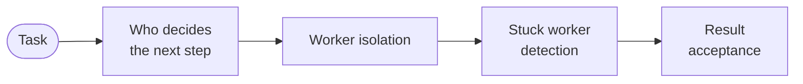
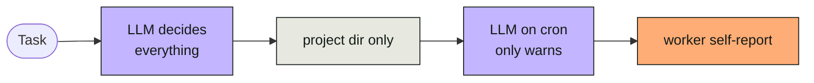
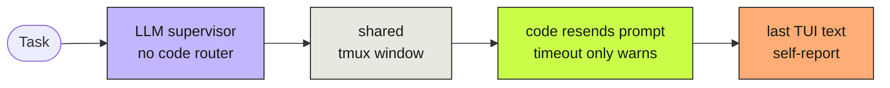
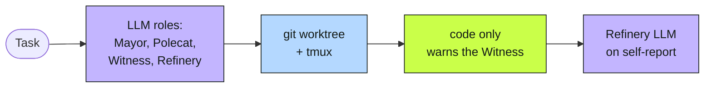
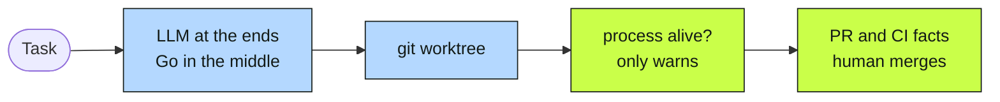
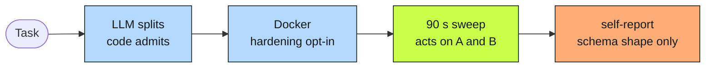
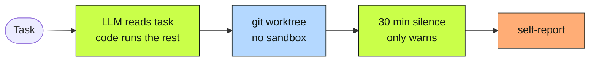
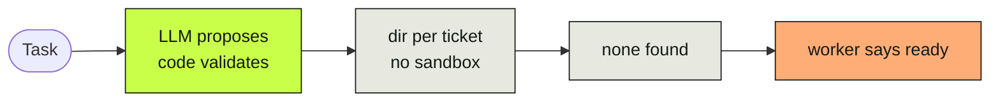
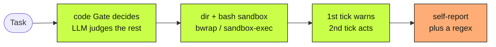
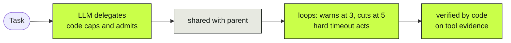

Same question for nine open-source orchestrators: when a task goes in, **who decides each step, the model or the code?**

One diagram each. Read left to right.

<!--truncate-->

## Colour key

| Colour | Meaning |
|---|---|
| 🟩 green | decided or done by **code** |
| 🟪 purple | decided by the **LLM** |
| 🟦 blue | mixed: LLM plus code |
| ⬜ grey | none found / shared |
| 🟧 orange | **self-report**: the worker grades itself |

## The flow every diagram follows

## The nine

### cc-super-agent

Everything in the prompt. Code only does logistics.

### cli-agent-orchestrator

An LLM supervisor, no router in code.

### gastown

Four LLM roles; code dispatches and warns.

### agent-orchestrator

LLM at the edges, deterministic Go in between.

### agent-swarm

Code filters, admits and claims; the sweep acts on stuck workers (cases A and B).

### super-super-harness

Code runs the queue, the worktree and the retries.

### dsh-superagent-prototype

Small and clean. No stuck-worker detection found.

### dsh-super-agent (LofiSu)

Per-worker bash sandbox at OS level (bwrap / sandbox-exec); the watchdog escalates.

### deer-flow

**Code checks** the result against tool evidence, if the lead passed criteria.

## What repeats

- 🟧 **Seven of nine accept the worker's own report** (gastown adds an LLM reviewer on top). Only deer-flow checks tool evidence in code, and only if the lead passed criteria; agent-orchestrator derives it from PR and CI facts.
- **Detection mostly warns.** Few detectors act (agent-swarm cases A and B, LofiSu 2nd tick, deer-flow timeout).
- **Isolation is weak by default.** A git worktree or a directory is the usual ceiling; only LofiSu (OS sandbox) and agent-swarm (Docker, hardening opt-in) go further.

## Explore them

Each diagram is interactive (zoom, focus, node index, every node with its `file:line` source): **[open the nine diagrams](https://valdepeace.github.io/agentscope/orquestacion.html)**.

## Limits

- Reading coverage is low (0.2 % to 32 % of each repo). Diagrams show what was read; «not found» means «not found in what I read».
- Nothing was run. No benchmarks, no timings, no cost.
- Diagram checks are automatic (schema, citations against the pinned commit, browser). None was reviewed by eye.

Scores, architecture-versus-claim and the rubric are in [the first post](/blog/2026/11/22/nine-code-agent-orchestrators) and in [the full study](https://github.com/valdepeace/agentscope/tree/main/orchestrators).
