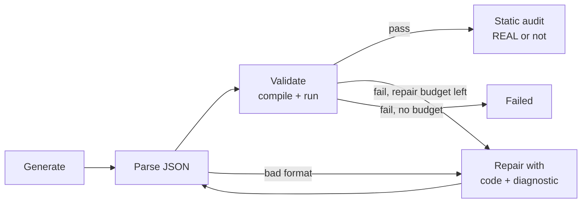

If a small local model writes a unit test, the test fails, and you hand the model the compiler or test error and let it try again, how much better does it get? A recent master's thesis says the loop helps. I replicated it on my own machine to see by how much, and the most useful thing I found was a bug in my own prompt.

**Research snapshot:** five local models · one RTX 3060 Ti (8 GB) · 10,800 runs in Java, Python and Node · two prompt versions in Java · every passing test audited · zero benchmark claims.

<!--truncate-->

import {GainChart, SymbolChart, LanguageChart} from '@site/src/components/VeraCharts';

## What VERA measures

VERA stands for *Validation · Execution · Repair · Audit*. The reference is a master's thesis (UNED, 2026), *Agentic Validate–Repair Workflows for Local Large Language Models: A Controlled Empirical Evaluation on Automated Unit Test Generation*. VERA-01 replicates its core comparison:

- **baseline**: the model gets one attempt to write a test for a focal method.
- **repair**: the same first attempt, plus up to three repairs, each one fed with the model's previous code and the diagnostic (compile error, failing test or malformed output).

Same prompt, same parameters, same validation command. The only thing that changes is the repair budget.

A green run is not enough. Every accepted test goes through a static audit that only counts it as **REAL** if it declares a test, contains assertions, and calls the focal method. Everything below is the REAL rate.

| Piece | What I used |
|---|---|
| GPU | RTX 3060 Ti, 8 GB |
| Server | Ollama 0.40.13, Q4_K_M models, `num_ctx` 8192, temperature 0.7 |
| Models | `llama3.1:8b`, `qwen2.5-coder:7b`, `qwen3:8b`, `gemma4:e4b`, plus `ornith-1.5:9b` in Java |
| Java | 20 methods of Apache Commons Lang, JUnit 5, Maven |
| Python | 20 methods of pydash, pytest |
| Node | 20 methods of validator.js, `node --test` |
| Plan | 20 methods × 15 repetitions × 2 conditions per model |

## Java: the loop helps every model, but not like in the thesis

With the first prompt (`vera01-p1`), repair improved all five models and no confidence interval touched zero. The spread between models was huge:

| Model | Baseline | Repair | Gain (pp, 95 % CI) | Thesis gain |
|---|---:|---:|---|---:|
| `qwen3:8b` | 0.0 % | 74.7 % | +75 [69, 79] | +9.3 |
| `ornith-1.5:9b` | 25.0 % | 64.0 % | +39 [31, 46] | — |
| `qwen2.5-coder:7b` | 32.3 % | 58.7 % | +26 [18, 34] | +20.0 |
| `llama3.1:8b` | 8.3 % | 53.3 % | +45 [38, 51] | +4.6 |
| `gemma4:e4b` | 6.0 % | 18.3 % | +12 [7, 18] | +34.0 |

The direction matches the thesis. The size and the ranking do not: gemma4 improves the most in the thesis and the least here, and qwen3 and llama3.1 do the opposite.

## The bug that inflated the effect

A baseline of 0 % for qwen3 looked wrong, so I read the failures. The prompt never told the model which package the class under test lives in. Most first attempts died on `cannot find symbol`, and the first repair fixed the import, because the compiler error tells you exactly what is missing.

Counting the repairs whose first failure was a symbol-resolution error: 97 % for qwen3, 84 % for llama3.1, 71 % for gemma4, 64 % for qwen2.5-coder and 36 % for ornith. In four of the five models, most of what I was crediting to the loop was the loop fixing my prompt.

<SymbolChart lang="en" />

I didn't touch the p1 data. I preregistered a second prompt (`vera01-p2`) that only adds the full import line, wrote down the success criterion before running it (the gain must exclude zero in at least three of five models), and ran another 3,000 runs:

| Model | Baseline p1 → p2 | Repair p1 → p2 | Gain p1 → p2 |
|---|---|---|---|
| `gemma4:e4b` | 6 % → 57 % | 18 % → 79 % | +12 → +21 |
| `llama3.1:8b` | 8 % → 51 % | 53 % → 63 % | +45 → +12 |
| `ornith-1.5:9b` | 25 % → 43 % | 64 % → 78 % | +39 → +35 |
| `qwen2.5-coder:7b` | 32 % → 55 % | 59 % → 70 % | +26 → +15 |
| `qwen3:8b` | 0 % → 34 % | 75 % → 42 % | +75 → +8 |

Every baseline jumps. The gain from the loop shrinks in four models, but it still excludes zero in four of five (all except qwen3), so the preregistered criterion holds. The loop is real; it is just much smaller once the prompt stops sabotaging the first attempt.

<GainChart lang="en" />

## Python and Node: smaller, steadier gains

Python and Node prompts have no import problem, so these runs (2,400 per language, prompt p1, the four thesis models) are closer to what the loop does on its own:

| Language | Model | Baseline | Repair | Gain (pp, 95 % CI) |
|---|---|---:|---:|---|
| Python | `gemma4:e4b` | 28 % | 53 % | +25 [17, 32] |
| Python | `llama3.1:8b` | 32 % | 53 % | +21 [13, 29] |
| Python | `qwen2.5-coder:7b` | 55 % | 68 % | +13 [6, 21] |
| Python | `qwen3:8b` | 50 % | 57 % | +7 [−1, 15] |
| Node | `gemma4:e4b` | 30 % | 58 % | +28 [20, 35] |
| Node | `llama3.1:8b` | 35 % | 47 % | +12 [4, 20] |
| Node | `qwen2.5-coder:7b` | 18 % | 29 % | +11 [5, 18] |
| Node | `qwen3:8b` | 50 % | 65 % | +15 [7, 23] |

<LanguageChart lang="en" />

Seven of eight cells improve with an interval that excludes zero, and the gains (+7 to +28 points) look like Java with p2, not Java with p1. One warning sign: gemma4 in Node produces empty tests in 10 % of its runs, which is why its raw pass rate with repair (65 %) is seven points above the REAL one.

## Two harness bugs, caught by the data

Twice, runs that the harness filed as infrastructure failures turned out to be something else:

- **Lone UTF-16 surrogates.** When a model wrote a JavaScript escape like `\ud800` without doubling the backslash, `json.loads` produced a lone surrogate that could not be written as UTF-8. 36 Node runs were lost this way, 35 of them on `isSurrogatePair`, so the exclusion was anything but random. The parser now writes the escape back as text.
- **"HTTP 500" that wasn't the server.** The last five invalid runs all failed with a 500. The engine threw the error body away; once I read it, it said `prediction aborted, token repeat limit reached`: Ollama cuts the generation when the model loops on the same tokens. That is the model failing, like running out of `num_predict`, so it now counts as a truncated output.

In both cases I fixed the harness, kept a copy of the invalid records, and re-ran only those runs, without touching the valid ones. Python and Node now stand at 2,400 of 2,400 valid runs each. No conclusion changed, but excluding those runs would have biased the rates in favor of success.

## So, is it the same conclusion as the thesis?

Yes, in what matters: a validate–repair loop makes small local models write more tests that really test something, in every model I tried and in all three languages. The details are where it gets interesting.

- **With my first prompt, it didn't look like the thesis at all.** Gains of up to +75 points and a model ranking turned upside down. That was the import gap, not the loop.
- **With the fair prompt, it does.** In p2 the gains (+8 to +35 points) fall in the same range as the thesis (+5 to +34), and the ranking is almost the same: gemma4 gains the most and qwen2.5-coder comes second in both; llama3.1 and qwen3 gain the least, just swapped.
- **The absolute rates don't replicate.** My p2 baselines (34–57 %) are well above the thesis ones (18–43 %). Half of the 20 methods are my own picks, because the thesis doesn't publish them, and the prompts are reconstructions, so I'd only compare gains, not levels.
- **Python and Node extend it.** The thesis only covers Java. The loop helps there too (+7 to +28 points), with the same size of effect as Java with the fair prompt.

The most useful lesson is less about the loop and more about measuring it: a repair loop is very good at hiding a broken prompt. If the first attempt fails for a reason the error message spells out, the loop will look brilliant.

## Before you quote any of this

- **REAL is a static audit.** It checks for a test, assertions and a call to the focal method. It does not run mutants, so a vacuous assertion can still count.
- **The intervals are optimistic.** Newcombe intervals treat runs as independent, but they share focal methods, model and validation command.
- **One machine, one context size, reconstructed prompts.** The thesis prompts are not published verbatim; mine are reconstructions, and p1 had the import gap described above.

## What's next

Code, plans, reports and the full write-up of every deviation are in [vera-replication](https://github.com/valdepeace/vera-replication) (MIT). The next step is VERA-02: taking the same loop to a fixed subset of Python and JavaScript tasks from DeepSWE, with the official verifier kept out of the repair loop and used only to score both branches at the end.
