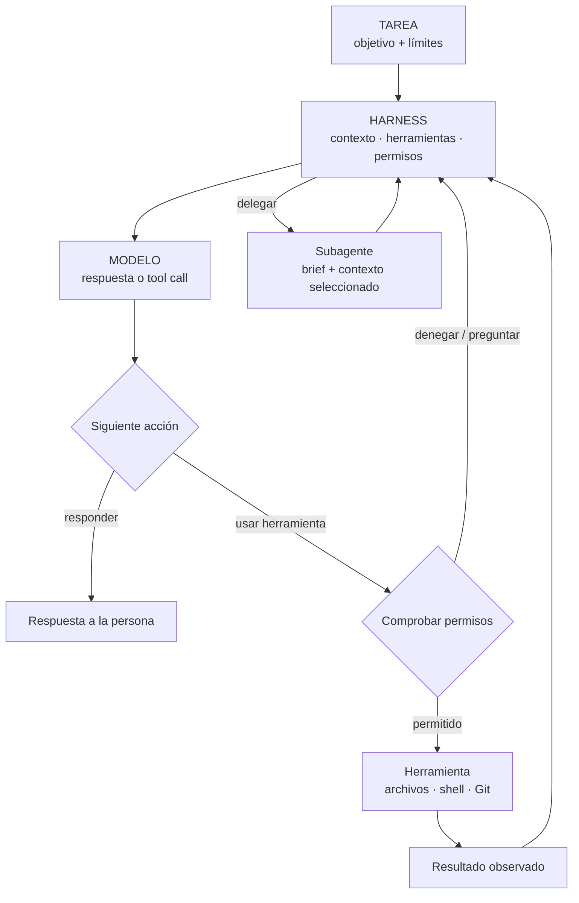
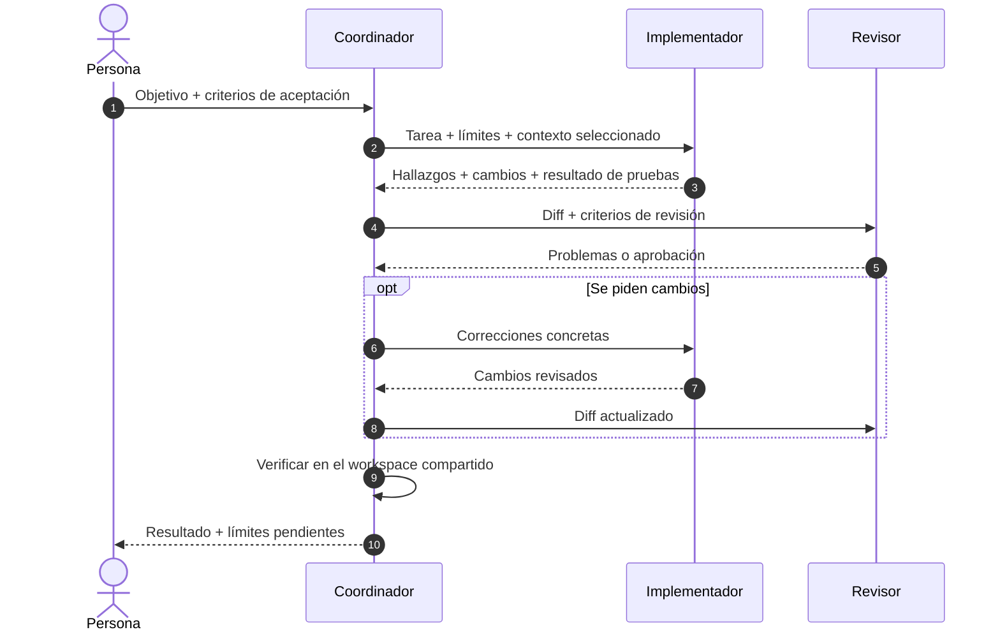

Un agente de programación es un sistema construido alrededor de un modelo. El harness aporta contexto y herramientas, aplica permisos, ejecuta acciones y decide el siguiente paso.

**Estudio y fuentes:** [comparativa interactiva de AgentScope](https://valdepeace.github.io/agentscope/) · [repositorio en GitHub](https://github.com/valdepeace/agentscope).

<!--truncate-->

| **74** productos catalogados | **40** repositorios públicos revisados por lenguaje |
| --- | --- |
| **41** capturas de estrellas · 25 oct 2026 | **0** experimentos controlados propios |

*Las estrellas miden interés, no calidad.*

## El bucle del agente

*Esquema conceptual: cada producto implementa y expone pasos distintos.*

## ¿Qué aporta cada capa?

| Capa | Aportación y evidencia que revisar |
| --- | --- |
| **Modelo** | Capacidad de programación y tool calling; revisar versión, formato de API y condiciones de tarea. |
| **System prompt** | Rol, prioridades y límites; localizar fuente oficial y añadidos del runtime. |
| **Harness** | Herramientas, permisos, reintentos, sesiones y delegación; inspeccionar bucle y políticas. |
| **Contexto + entorno** | Reglas, archivos, historial, tests y accesos; comprobar qué recibió el agente. |

Las capas interactúan; este estudio no les asigna porcentajes. Un fragmento público no siempre es el prompt efectivo completo: el runtime puede añadir modos, herramientas y reglas del proyecto. Si una muestra de prompt no tiene una fuente verificable, el catálogo no la reconstruye.

## Delegación: ¿quién envía qué a quién?

*Es un modelo para comparar, no una transcripción atribuida a todos los productos. Algunos workers comparten workspace; otros devuelven mensajes o parches. El orquestador debe comprobar el resultado.*

Un buen encargo transmite **objetivo, límites, contexto relevante y criterios de aceptación**. Una buena respuesta devuelve **hallazgos, archivos modificados y pruebas de verificación**. Con poco contexto, el worker se desvía; con demasiado, la tarea queda enterrada.

## Tres protocolos, tres trabajos

| Protocolo | Límite |
| --- | --- |
| **A2A** | Descubrimiento e intercambio de tareas y mensajes; el producto puede no tener soporte nativo. |
| **ACP** | Editor ↔ agente de programación; esto no implica delegación entre agentes. |
| **MCP** | Host de agente ↔ herramientas/datos; no es comunicación agente a agente. |

Dos CLI oficiales tienen rutas A2A en las fuentes revisadas:

| CLI | Ruta respaldada por fuentes | Límite |
| --- | --- | --- |
| **Gemini CLI** | Se conecta a agentes remotos mediante Agent Cards de A2A. | Ser cliente no demuestra que ofrezca su propio endpoint A2A. |
| **Qwen Code** | Las notas oficiales anuncian colaboración entre CLIs; su diseño marca A2A sobre sesiones como implementado tras `experimental.agentCollaboration` (desactivado por defecto). | Qwen coordina la sesión; esto no convierte a Claude Code ni Codex en peers A2A nativos. |

Los adaptadores documentados de Qwen pueden ejecutar Qwen Code, Claude Code o Codex localmente o mediante un host Qwen remoto. El coordinador lleva el flujo de colaboración; hay que comprobar la versión y la opción experimental antes de darlo por disponible. [Diseño oficial](https://github.com/QwenLM/qwen-code/blob/main/docs/design/2026-10-05-session-multi-agent.md) · [Actualización de Qwen](https://qwenlm.github.io/qwen-code-docs/en/blog/updates/weekly-update-2026-10-15/)

Invocar el CLI de A2A como herramienta o usar un puente comunitario también puede conectar otros productos, pero eso es una integración alrededor de ellos, no una prueba de soporte nativo.

## Qué permite afirmar esta instantánea

El endpoint Languages de GitHub informa de bytes por lenguaje detectado, no de todo el runtime ni de lo que se distribuye al usuario. Las estrellas cambian y no miden calidad. Los tamaños de artefactos solo se comparan si coinciden versión, plataforma, arquitectura y formato del paquete.

No se ejecutaron benchmarks controlados. La evidencia permite describir el sistema, no establecer un ranking de rendimiento ni repartir porcentajes entre modelo, prompt y harness. «No verificado» significa que en esta pasada no se confirmó una fuente; no significa «no soportado».

## Conclusión: fragmentado por defecto

| Evidencia de esta revisión | Lectura respaldada | Límite |
| --- | --- | --- |
| 74 productos catalogados | No se observa un contrato común por defecto para delegar, transferir contexto, aplicar permisos y devolver resultados. | La matriz de fuentes sigue incompleta. |
| Gemini CLI y Qwen Code | Ambos proyectos documentan rutas A2A oficiales. | La de Qwen es opt-in; sus adaptadores no convierten Claude Code o Codex en clientes A2A nativos. |
| ACP y MCP | Conectan editores con agentes, y agentes con herramientas/datos. | Ninguno sustituye a A2A. |

«Cada uno hace la guerra por su cuenta» resume bien el comportamiento por defecto: orquestación específica de cada producto y algunos puentes. No demuestra que estén totalmente aislados. Es una lectura cualitativa de las fuentes revisadas, no un recuento completo de implementaciones ni un benchmark de interoperabilidad.

## Fuentes

- [Agentes remotos de Gemini CLI](https://github.com/google-gemini/gemini-cli/blob/main/docs/core/remote-agents.md)
- [Diseño multiagente de Qwen Code](https://github.com/QwenLM/qwen-code/blob/main/docs/design/2026-10-05-session-multi-agent.md) · [Actualización de Qwen](https://qwenlm.github.io/qwen-code-docs/en/blog/updates/weekly-update-2026-10-15/)
- [Especificación A2A](https://github.com/a2aproject/A2A/blob/main/docs/specification.md) · [conceptos A2A](https://github.com/a2aproject/A2A/blob/main/docs/index.md)
- [API Languages de GitHub](https://docs.github.com/en/rest/repos/repos#list-repository-languages)
- [Introducción a ACP](https://agentclientprotocol.com/get-started/introduction) · [Introducción a MCP](https://modelcontextprotocol.io/introduction)
- [CLI oficial de A2A](https://github.com/a2aproject/a2a-cli)
