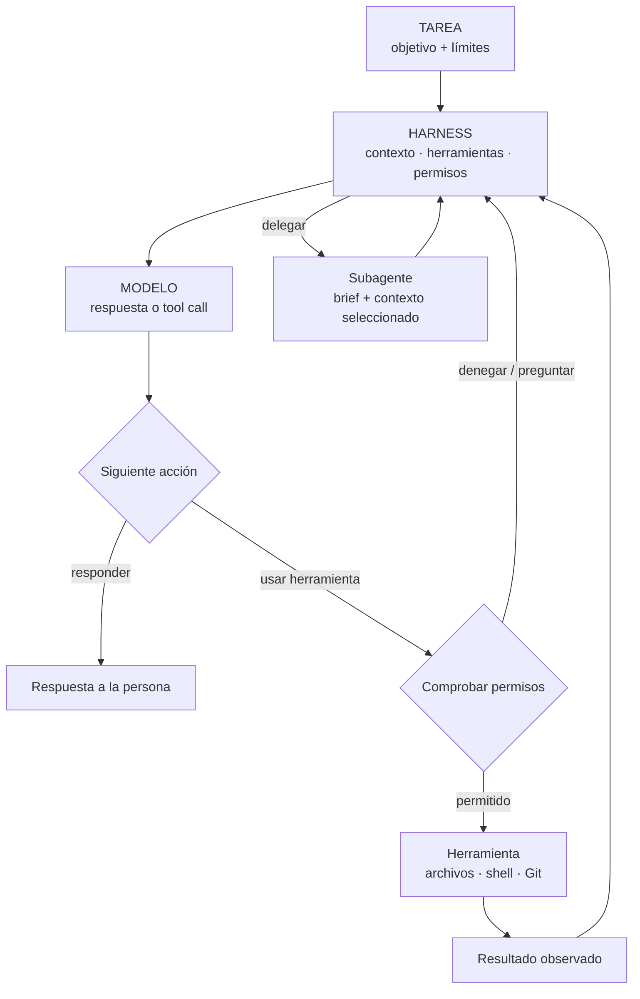
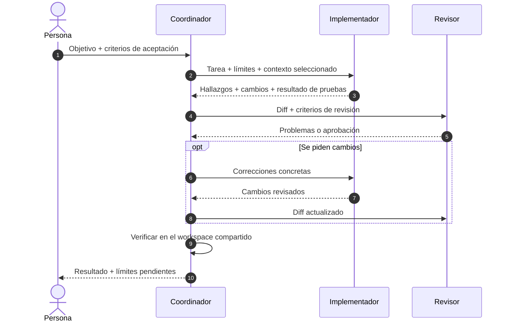

Un agente de programación es un sistema construido alrededor de un modelo. El harness aporta contexto y herramientas, aplica permisos, ejecuta acciones y decide el siguiente paso.

<!--truncate-->

| **74** productos catalogados | **40** repositorios públicos revisados por lenguaje | **41** capturas de estrellas |
| --- | --- | --- |
| **0** experimentos controlados propios | Instantánea: 25 oct 2026 | Las estrellas miden interés, no calidad |

## El bucle del agente

*Esquema conceptual: cada producto implementa y expone pasos distintos.*

## ¿Qué aporta cada capa?

| Capa | Qué aporta | Qué conviene inspeccionar |
| --- | --- | --- |
| **Modelo** | Capacidad de programación, tool calling y formato de contexto | Versión, formato de API y condiciones de la tarea |
| **System prompt** | Rol, prioridades, flujo de trabajo y límites | Fuente oficial, versión exacta y añadidos del runtime |
| **Harness** | Herramientas, permisos, reintentos, sesiones y delegación | Bucle de herramientas, políticas y errores |
| **Contexto + entorno** | Reglas del proyecto, archivos, historial, tests y accesos | Qué recibió el agente y qué pudo modificar |

Las capas interactúan; este estudio no les asigna porcentajes. Un fragmento público no siempre es el prompt efectivo completo: el runtime puede añadir modos, herramientas y reglas del proyecto. Si una muestra de prompt no tiene una fuente verificable, el catálogo no la reconstruye.

## Delegación: ¿quién envía qué a quién?

*Es un modelo para comparar, no una transcripción atribuida a todos los productos. Algunos workers comparten workspace; otros devuelven mensajes o parches. El orquestador debe comprobar el resultado.*

Un buen encargo transmite **objetivo, límites, contexto relevante y criterios de aceptación**. Una buena respuesta devuelve **hallazgos, archivos modificados y pruebas de verificación**. Con poco contexto, el worker se desvía; con demasiado, la tarea queda enterrada.

## Tres protocolos, tres trabajos

| Protocolo | Conecta | No demuestra |
| --- | --- | --- |
| **A2A** | Agentes mediante descubrimiento e intercambio de tareas y mensajes | Soporte nativo en un producto de programación |
| **ACP** | Un editor y un agente de programación | Delegación entre agentes |
| **MCP** | El host de un agente con herramientas o datos | Comunicación entre agentes |

La documentación de Gemini CLI revisada configura agentes remotos mediante Agent Cards de A2A. Eso verifica una ruta cliente A2A nativa; no demuestra que Gemini CLI ofrezca un endpoint A2A. Un puente comunitario o invocar el CLI de A2A como herramienta son integraciones alrededor del producto, no pruebas de soporte nativo.

## Qué permite afirmar esta instantánea

El endpoint Languages de GitHub informa de bytes por lenguaje detectado, no de todo el runtime ni de lo que se distribuye al usuario. Las estrellas cambian y no miden calidad. Los tamaños de artefactos solo se comparan si coinciden versión, plataforma, arquitectura y formato del paquete.

No se ejecutaron benchmarks controlados. La evidencia permite describir el sistema, no establecer un ranking de rendimiento ni repartir porcentajes entre modelo, prompt y harness. «No verificado» significa que en esta pasada no se confirmó una fuente; no significa «no soportado».

## Fuentes

- [Agentes remotos de Gemini CLI](https://github.com/google-gemini/gemini-cli/blob/main/docs/core/remote-agents.md)
- [Especificación A2A](https://github.com/a2aproject/A2A/blob/main/docs/specification.md) · [conceptos A2A](https://github.com/a2aproject/A2A/blob/main/docs/index.md)
- [API Languages de GitHub](https://docs.github.com/en/rest/repos/repos#list-repository-languages)
- [Introducción a ACP](https://agentclientprotocol.com/get-started/introduction) · [Introducción a MCP](https://modelcontextprotocol.io/introduction)
- [CLI oficial de A2A](https://github.com/a2aproject/a2a-cli)
