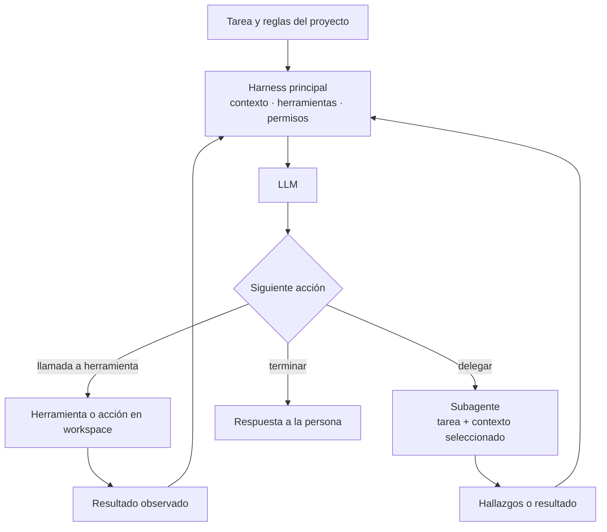
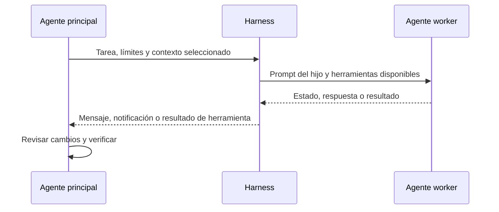

Cuando un agente de programación delega trabajo, ¿qué recibe realmente el subagente? ¿Hereda la conversación, recibe un encargo nuevo o se comunica mediante un protocolo compartido con otros productos?

Esa es la pregunta de esta primera revisión en profundidad. Empezamos con un inventario de 74 agentes y productos relacionados; la cobertura es desigual, así que esa cifra es un mapa de candidatos, no 74 agentes auditados por igual. Esta primera revisión del código abarca cinco repositorios: Codex CLI, Gemini CLI, OpenCode, Crush y Qwen Code.

**Instantánea de investigación:** cinco commits de código fijados · cero ejecuciones de agentes · cero resultados de benchmark.

<!--truncate-->

## Un agente es un runtime alrededor de un modelo

El LLM no lee un repositorio ni ejecuta sus pruebas por sí solo. El harness selecciona contexto y herramientas, comprueba permisos, ejecuta las llamadas y devuelve observaciones al modelo. La delegación añade otra transferencia de contexto y un resultado más que el agente principal debe evaluar.

El diagrama es un modelo útil para comparar. Cada repositorio implementa detalles distintos; no es el registro de una ejecución de benchmark.

La pregunta sobre la delegación es más concreta: el agente principal decide qué enviar, el runtime inicia al hijo y el principal conserva la responsabilidad de revisar y verificar.

*Esquema de comparación: cada harness empaqueta y devuelve el trabajo de forma distinta.*

## Cinco implementaciones, cinco formas de delegar

| Agente | Qué muestra el código revisado | Límite de comunicación |
|---|---|---|
| **Codex CLI** | Inicia hilos hijos y prepara el historial heredado. La capa de control expone mensajes internos, listado e interrupción. ([spawn](https://github.com/openai/codex/blob/970111f6cb62cc02fe36a82ea7d71b37a2889c97/codex-rs/core/src/agent/control/spawn.rs), [control](https://github.com/openai/codex/blob/970111f6cb62cc02fe36a82ea7d71b37a2889c97/codex-rs/core/src/agent/control.rs)) | Coordinación interna del runtime; esto no demuestra que tenga un endpoint A2A. |
| **Gemini CLI** | Su herramienta Agent pide al principal un encargo completo y detallado. La invocación local y la remota siguen rutas distintas; la sesión remota conserva `contextId` y `taskId` de A2A. ([herramienta](https://github.com/google-gemini/gemini-cli/blob/cd1b45c2db0a5ea7b7fc3b67c1ba5879601d6005/packages/core/src/agents/agent-tool.ts), [sesión remota](https://github.com/google-gemini/gemini-cli/blob/cd1b45c2db0a5ea7b7fc3b67c1ba5879601d6005/packages/core/src/agents/remote-session-invocation.ts)) | Cliente A2A localizado en este snapshot; aquí no se verificó un servidor conforme. |
| **OpenCode** | Crea una sesión hija, permite ejecutarla en segundo plano y devuelve una notificación/resultado al principal. ([herramienta de subagente](https://github.com/anomalyco/opencode/blob/450e7b92412c780a7b5a75226bb8d49aaca24e22/packages/core/src/tool/plugin/subagent.ts), [finalización](https://github.com/anomalyco/opencode/blob/450e7b92412c780a7b5a75226bb8d49aaca24e22/packages/core/src/session/subagent-completion.ts)) | Sesiones y transferencia propias del producto; no localizamos A2A en las rutas revisadas. |
| **Crush** | Construye un agente de tarea y lo ejecuta mediante una herramienta de agentes paralelos. La llamada requiere identificadores de sesión y mensaje del runtime. ([agent tool](https://github.com/charmbracelet/crush/blob/9ab41e330eb47057a328ba2aeba3c702522a43eb/internal/agent/agent_tool.go)) | Delegación local paralela; no localizamos A2A en las rutas revisadas. |
| **Qwen Code** | Ofrece subagentes de tarea y un fork explícito de la conversación. El código revisado también implementa un servidor externo A2A 1.0 JSON-RPC, protegido por `agentCollaboration`, opción experimental desactivada por defecto. ([herramienta de agente](https://github.com/QwenLM/qwen-code/blob/41ce46af24c0bda9441216191a4b119fef846fab/packages/core/src/tools/agent/agent.ts), [contrato A2A](https://github.com/QwenLM/qwen-code/blob/41ce46af24c0bda9441216191a4b119fef846fab/packages/core/src/agents/workspace-agents/a2a-contract.ts), [configuración](https://github.com/QwenLM/qwen-code/blob/41ce46af24c0bda9441216191a4b119fef846fab/packages/cli/src/config/config.ts)) | El endpoint es opt-in. Un agente externo no puede aprobar una acción local de herramienta en nombre de quien controla el workspace. |

Esto acredita mecanismos presentes en esos commits concretos. No demuestra que todas las rutas estén activas en cada versión ni que los productos interoperen correctamente. La delegación interna y A2A son capas distintas.

## Los prompts tampoco son todos la misma clase de evidencia

La revisión encontró extractos breves y verificables. No son prompts efectivos completos: el runtime puede añadir instrucciones de herramientas, reglas del proyecto, texto específico del modo y contexto de conversación.

| Agente | Extracto literal | Tipo de artefacto |
|---|---|---|
| Codex CLI | «You are a coding agent running in the Codex CLI…» ([fuente](https://github.com/openai/codex/blob/970111f6cb62cc02fe36a82ea7d71b37a2889c97/codex-rs/models-manager/prompt.md)) | Prompt de sistema publicado |
| Gemini CLI | «The COMPLETE query to send the subagent. MUST be comprehensive and detailed.» ([fuente](https://github.com/google-gemini/gemini-cli/blob/cd1b45c2db0a5ea7b7fc3b67c1ba5879601d6005/packages/core/src/agents/agent-tool.ts)) | Esquema de herramienta de agente, no system prompt principal |
| OpenCode | «You are an AI agent running in OpenCode, a coding agent harness.» ([fuente](https://github.com/anomalyco/opencode/blob/450e7b92412c780a7b5a75226bb8d49aaca24e22/packages/core/src/session/runner/prompt/system.txt)) | Plantilla de prompt común |
| Crush | «You are Crush, a powerful AI Assistant that runs in the CLI.» ([fuente](https://github.com/charmbracelet/crush/blob/9ab41e330eb47057a328ba2aeba3c702522a43eb/internal/agent/templates/coder.md.tpl)) | Plantilla del rol coder |
| Qwen Code | `You are Qwen Code, ${role} developed by Alibaba Group…` ([fuente](https://github.com/QwenLM/qwen-code/blob/41ce46af24c0bda9441216191a4b119fef846fab/packages/core/src/core/prompts.ts)) | Plantilla de identidad dinámica |

La distinción importa: las instrucciones a un subagente, una plantilla de rol y un system prompt completo no son muestras intercambiables.

## Qué podemos afirmar por ahora

En este primer grupo, delegar no es una función común con el mismo formato de transferencia. Los productos difieren en la conversación que hereda el hijo, cómo se empaqueta la tarea, si el trabajo corre en segundo plano y cómo vuelve el progreso o el resultado. El soporte A2A debe describirse aparte de esos mecanismos internos.

La conclusión inicial es que los agentes de programación están fragmentados por defecto en la capa de orquestación. Eso no significa que no puedan conectarse: existen adaptadores y protocolos externos. Significa que la interoperabilidad debe demostrarse entre implementaciones concretas, no deducirse de la palabra «agente».

## Qué aún no sabemos

Inspeccionamos código, pero no ejecutamos los agentes, no probamos A2A entre productos ni comparamos resultados. Tampoco hemos recorrido todos los bucles de herramientas, reintentos, límites de permisos y límites de contexto. No tenemos una respuesta medida sobre cuánto depende el comportamiento del modelo, del prompt o del harness; para responder hace falta experimentar manteniendo constantes esas variables.

Las siguientes revisiones ampliarán la auditoría de código antes de hacer afirmaciones de rendimiento. El [sitio del estudio](https://valdepeace.github.io/agentscope/) y el [repositorio](https://github.com/valdepeace/agentscope) reúnen el inventario, el registro de fuentes y las incertidumbres.
