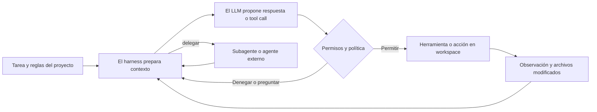

Cuando un agente de programación modifica un repositorio, el modelo de lenguaje es solo una parte del sistema. El harness elige qué contexto enviar, qué herramientas exponer, cómo ejecutarlas, qué hacer ante los errores y cuándo detenerse. El prompt orienta al modelo, pero no le concede acceso al sistema de archivos ni ejecuta por sí solo un comando de shell.

He estado comparando esas piezas en 74 agentes de programación y productos relacionados. Es una instantánea basada en fuentes, no un ranking: los sistemas cerrados son más difíciles de inspeccionar y una capacidad no documentada queda como no verificada.

<!--truncate-->

## El modelo no es el agente

Una forma útil de entenderlo es como un bucle. El modelo propone texto o una llamada estructurada a una herramienta; el harness comprueba permisos, ejecuta una acción y devuelve el resultado como nuevo contexto. La siguiente respuesta depende de esa retroalimentación y del prompt inicial.

Por eso, una comparación de prompts debe mantener constantes el modelo y las herramientas. Una comparación de harnesses debe fijar modelo, tarea y entorno. Sin esos controles, decir que «un agente lo hizo mejor» no identifica qué capa causó la diferencia.

## Prompts: primero la evidencia

El código fuente y la documentación pública muestran fragmentos útiles de algunos agentes. No siempre revelan el prompt efectivo completo. Una plantilla puede incluir variables, instrucciones específicas del modo, descripciones de herramientas y reglas del proyecto añadidas en tiempo de ejecución. Un ejemplo escrito por un usuario no es el prompt por defecto del fabricante.

Por eso el catálogo acompaña cada muestra de una etiqueta de procedencia y un enlace. Si no encontramos un fragmento verificable, lo indicamos en vez de reconstruirlo. Esto importa especialmente en productos cerrados como Cursor, Devin y Windsurf: un texto filtrado o recopilado por la comunidad no se convierte automáticamente en un prompt oficial.

## Subagentes y comunicación

Delegar es una función del runtime. Un controlador prepara una tarea y parte del contexto, inicia o contacta con un worker y decide cómo recibir y revisar el resultado. Algunos sistemas devuelven un informe; otros comparten tareas, mensajes o workspace. Un contexto nuevo puede reducir ruido, pero omitir interfaces o restricciones puede llevar al worker a resolver el problema equivocado.

La comparativa distingue tres protocolos:

| Mecanismo | Conexión que estandariza | Lo que no demuestra |
| --- | --- | --- |
| A2A | Agente con agente: descubrimiento e intercambio de mensajes y tareas | Que un producto de coding implemente A2A de forma nativa |
| ACP | Editor con agente de programación | Que el agente coordine con otro agente |
| MCP | Host del agente con herramientas y datos | Comunicación entre agentes |

En la documentación oficial de Gemini CLI consultada para esta revisión, los agentes remotos se configuran mediante Agent Cards de A2A. Eso confirma una ruta cliente A2A nativa; no demuestra que Gemini CLI publique su propio endpoint A2A. La matriz de 74 fichas separa la delegación interna documentada de A2A y marca como no verificados los casos que aún no se han comprobado. La especificación A2A tampoco prescribe cómo debe hablar un agente con sus subagentes.

Un agente también puede llamar al CLI oficial de A2A como herramienta o quedar envuelto por un puente comunitario. Esas vías conectan sistemas que de otro modo no serían compatibles, pero son integraciones alrededor del producto: no demuestran que el producto implemente A2A.

## Qué nos dice GitHub sobre la implementación

Para 40 repositorios públicos o archivados enlazados desde el catálogo, consulté el endpoint Languages de GitHub el 25 de octubre de 2026. Devuelve bytes por lenguaje detectado en un repositorio; la tabla muestra los principales. No describe todas las dependencias del runtime ni demuestra qué lenguajes se distribuyen en la aplicación final.

La instantánea refleja una implementación variada: Rust destaca en Codex, Goose, Zed y varias herramientas de terminal; TypeScript aparece en muchos productos de editor y CLI; Python es habitual en harnesses de investigación y SDK. Son observaciones de repositorios, no explicaciones de por qué sus mantenedores eligieron esos lenguajes. Esa motivación queda pendiente hasta localizar una fuente primaria que la explique.

También recogí estrellas de GitHub para 41 repositorios enlazados, en la misma fecha. Las estrellas cambian y no miden calidad. Algunas fichas no tienen un repositorio público vinculado. El repositorio de Seed pertenece al ecosistema/modelo, no a un harness de programación, y está identificado como tal.

Los tamaños de artefactos requieren la misma cautela. Un archivo Linux comprimido, un paquete npm descomprimido y un ejecutable independiente miden cosas distintas. Cuando hay una medida disponible, el catálogo indica versión, plataforma, arquitectura y formato; no los convierte en un ranking universal de «tamaño del agente».

## Qué responde la evidencia y qué no

Esta primera revisión permite una conclusión práctica: el comportamiento surge conjuntamente del modelo, el prompt, el harness, el contexto, las herramientas y el entorno. No asigna un porcentaje a cada capa. Los prompts públicos están incompletos, muchos runtimes comerciales son opacos y «no verificado» significa que no quedó demostrado en esta revisión, no que el producto carezca de la función.

Este artículo no incluye benchmarks propios. Un experimento justo variaría un factor cada vez: mismo modelo con distintos prompts, mismo modelo y prompt en distintos harnesses, mismo harness con distintos modelos, y delegación o skills activadas frente a desactivadas. Habría que medir tareas resueltas, regresiones, llamadas a herramientas, delegaciones, tokens, latencia y coste, y evaluar los cambios con tests independientes.

El siguiente paso es terminar la verificación de fuentes de las filas A2A y de tecnología pendientes, fijar los commits de los repositorios para hacer reproducibles las instantáneas y ejecutar tareas controladas antes de afirmar diferencias de rendimiento.

## Fuentes

- [Especificación A2A](https://github.com/a2aproject/A2A/blob/main/docs/specification.md) y [conceptos A2A](https://github.com/a2aproject/A2A/blob/main/docs/index.md)
- [Agentes remotos en Gemini CLI](https://github.com/google-gemini/gemini-cli/blob/main/docs/core/remote-agents.md)
- [API Languages de GitHub](https://docs.github.com/en/rest/repos/repos#list-repository-languages)
- [CLI oficial de A2A](https://github.com/a2aproject/a2a-cli)
- [Introducción a ACP](https://agentclientprotocol.com/get-started/introduction) · [Introducción a MCP](https://modelcontextprotocol.io/introduction)

