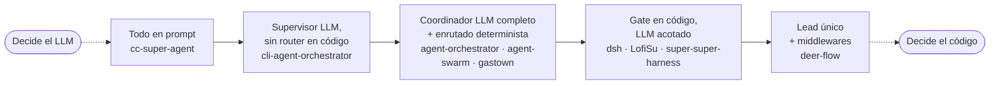
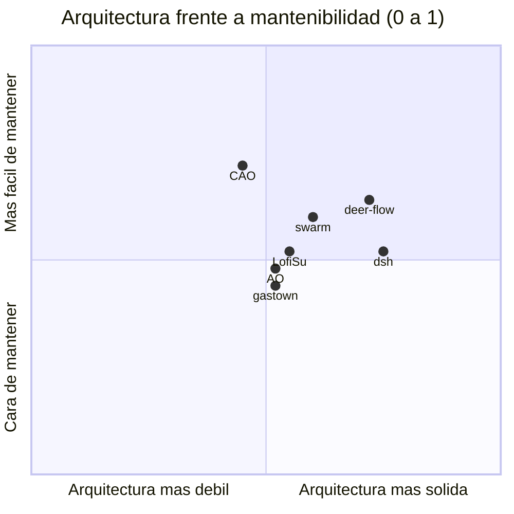

¿Qué parte de un orquestador de agentes debería ser un LLM y cuál debería ser código normal?

Para averiguarlo leí nueve orquestadores de código abierto. Este post es el resumen; la versión larga lleva citas con fichero y línea.

**Instantánea de investigación:** nueve repositorios · solo lectura de código · nada ejecutado · 807 citas fichero:línea recomprobadas, 72 muestreadas (ninguna contradicha) · cobertura de lectura entre el 0,2 % y el 32 % por repo.

<!--truncate-->

## Los nueve de un vistazo

| Repo | Origen | Estrellas | Lenguaje | Último push |
|---|---|---:|---|---|
| [deer-flow](https://github.com/bytedance/deer-flow) | ByteDance | 85.571 | Python + Next.js | 2026-11-21 |
| [gastown](https://github.com/gastownhall/gastown) | Organización, un autor principal | 18.862 | Go | 2026-11-14 |
| [agent-orchestrator](https://github.com/OrchestratorInc/agent-orchestrator) | Organización, producto comercial | 14.996 | Go + Electron | 2026-11-21 |
| [dsh-superagent-prototype](https://github.com/deepseek-ai/dsh-superagent-prototype) | DeepSeek, prototipo oficial | 24.127 | TypeScript | 2026-11-03 |
| [cli-agent-orchestrator](https://github.com/awslabs/cli-agent-orchestrator) | AWS Labs | 1619 | Python | 2026-11-21 |
| [agent-swarm](https://github.com/desplega-ai/agent-swarm) | Organización | 1097 | Bun / TypeScript | 2026-11-21 |
| [dsh-super-agent](https://github.com/LofiSu/dsh-super-agent) | Autor independiente | 146 | TypeScript | 2026-11-21 |
| [cc-super-agent](https://github.com/yingpengma/cc-super-agent) | Autor independiente | 7 | Bash + JS | 2026-11-02 |
| [super-super-harness](https://github.com/ketchupz1999/super-super-harness) | Autor independiente | 1 | Python | 2026-11-04 |

*Datos de GitHub del 21-11-2026. El prototipo oficial de DeepSeek tiene unas 24.000 estrellas y un solo commit: es tirón de marca, no uso.*

## Un eje explica casi toda la diferencia: quién decide

Más lógica en código hace el comportamiento más **verificable**. Nada en los nueve demuestra que dé **mejores resultados**: sigue sin medirse.

## Tres escaleras

| Repo | Aislamiento del worker | Detección de worker colgado | Aceptación del resultado |
|---|---|---|---|
| cc-super-agent | ninguno | LLM por cron, solo avisa | autoinforme |
| dsh-superagent-prototype | ninguno | ninguna | autoinforme |
| super-super-harness | ninguno | código, con acción | autoinforme |
| LofiSu | sandbox del SO (macOS/Linux) | código, con acción | autoinforme |
| agent-orchestrator | git worktree | solo comprueba que el proceso vive | derivada de hechos del PR y CI |
| gastown | git worktree | daemon sobre un agente; el resto son agentes LLM | autoinforme |
| agent-swarm | Docker, opt-in, red abierta | clasificador en código | autoinforme |
| cli-agent-orchestrator | pods desechables (solo ejemplo) | regex sobre la pantalla del TUI | autoinforme («falsa victoria») |
| deer-flow | compartido con el padre | bucles y heartbeats | **verificada por código** |

El aislamiento es flojo por defecto en todos. Solo deer-flow decide la aceptación en código, sobre evidencia de herramientas.

## Puntuación (7 repos, de 0 a 10)

| Repo | Origen | Arquitectura | Mantenibilidad |
|---|---|---|---|
| [deer-flow](https://github.com/bytedance/deer-flow) | ByteDance | ███████░░░ 7.2 | ██████░░░░ 6.4 |
| [dsh-superagent-prototype](https://github.com/deepseek-ai/dsh-superagent-prototype) | DeepSeek, prototipo oficial | ████████░░ 7.5 | █████░░░░░ 5.2 |
| [agent-swarm](https://github.com/desplega-ai/agent-swarm) | Organización | ██████░░░░ 6 | ██████░░░░ 6 |
| [cli-agent-orchestrator](https://github.com/awslabs/cli-agent-orchestrator) | AWS Labs | █████░░░░░ 4.5 | ███████░░░ 7.2 |
| [dsh-super-agent](https://github.com/LofiSu/dsh-super-agent) | Autor independiente | ██████░░░░ 5.5 | █████░░░░░ 5.2 |
| [agent-orchestrator](https://github.com/OrchestratorInc/agent-orchestrator) | Organización, producto comercial | █████░░░░░ 5.2 | █████░░░░░ 4.8 |
| [gastown](https://github.com/gastownhall/gastown) | Organización, un autor principal | █████░░░░░ 5.2 | ████░░░░░░ 4.4 |

*Etiquetas del gráfico: dsh = prototipo de DeepSeek, AO = agent-orchestrator, swarm = agent-swarm, CAO = cli-agent-orchestrator.*

Cómo se calcula: la arquitectura es la media de cinco criterios (fronteras, acoplamiento, extensibilidad, estado, resiliencia). La mantenibilidad, la media de otros cinco (tamaño de ficheros, tests, puertas de CI, documentación, salud del proyecto). El tamaño de ficheros y la proporción de tests son mecánicos; el resto son juicios con evidencia citada. Un fichero de 8.000 a 14.000 líneas saca 0 en tamaño, aunque sus tests y su CI sean los mejores del grupo.

El prototipo oficial puntúa alto sobre todo porque es pequeño (unas 15.000 líneas, sin CI y con un commit). No lo compares con proyectos de diez a cien veces más grandes.

## Lo que dice ser cada uno y lo que muestra el código

| Repo | Dice | El código muestra | Distancia |
|---|---|---|---|
| dsh | Núcleo de dominio puro | Núcleo puro; la capa de aplicación, enredada | Corta |
| LofiSu | Motor síncrono y arnés asíncrono | Núcleo limpio, un módulo de cableado de 3.231 líneas | Media |
| deer-flow | Tres paquetes, el harness nunca importa la app | Frontera exterior hecha cumplir por un test; 23 imports mutuos dentro | Media |
| agent-orchestrator | Hexagonal, los adaptadores son hojas | Hexagonal con fugas documentadas | **Larga** |
| agent-swarm | La API es dueña de la BD, los workers usan HTTP | Frontera vigilada en CI; el núcleo se acopla con todo | Media |
| cli-agent-orchestrator | Capas estrictas | Capas cruzadas, ciclos disimulados con 128 imports diferidos | **Larga** |
| gastown | Jerarquía de roles sobre un libro mayor compartido | El control suele vivir en prompts; el motor de merge en Go no tiene llamador | **Larga** |

Las reglas que aguantan son las que hace cumplir una máquina: un test AST, un script de CI o el compilador de Go.

## ¿Importa quién lo construye?

| Origen | Patrón observado |
|---|---|
| Empresa o equipo (deer-flow, agent-orchestrator, agent-swarm, cli-agent-orchestrator) | Mejor CI y tests, **y** los ficheros más grandes |
| Autor independiente (LofiSu, cc-super-agent, super-super-harness) | Código pequeño y coherente, pero un solo autor y sin comunidad |
| Prototipo oficial (dsh) | Código limpio, sin CI, un commit |
| Nombre de organización, un autor principal (gastown) | 65 % de los commits del top 100 de una persona; sin release desde junio |

Tómalo como una pista. Son entre siete y nueve repositorios de tamaños y edades muy distintos, y los pequeños los leí más completos, lo que los infla.

## Merece la pena copiar

| Idea | De |
|---|---|
| Permiso (inmutable) separado del contexto (sin autoridad) | dsh |
| Efectos encolados dentro de la transacción (outbox) | dsh |
| At-most-once por turno y failover del router con sondas | super-super-harness |
| Aceptación decidida en código sobre evidencia de herramientas | deer-flow |
| Una sonda fallida no prueba que la sesión esté muerta | agent-orchestrator |

## Sigue abierto

- Aislamiento real y portable del worker.
- Defensa técnica contra prompt injection.
- Tope de coste por tarea.
- Evidencia de que el diseño dual router y worker supera a un único agente bueno.

## Lee el estudio completo

Un diagrama interactivo por orquestador: [ver los flujos](/es/blog/2026/11/22/orchestrators-one-diagram-each) · [abrirlos directamente](https://valdepeace.github.io/agentscope/orquestacion.html).

Notas por repositorio, tablas comparativas, la rúbrica de puntuación y los diagramas interactivos: [agentscope/orchestrators](https://github.com/valdepeace/agentscope/tree/main/orchestrators).

## Límites

- La cobertura de lectura es baja: del 0,2 % al 32 % de las líneas de cada repo. Los recuentos y los grafos de imports cubren todos los ficheros; el comportamiento, solo lo que leí.
- «No encontrado» significa «no encontrado en lo que leí».
- No se ejecutó nada. Sin benchmarks, sin tiempos, sin cifras de coste.
- Las puntuaciones de 0 a 10 son juicios con reglas explícitas, no mediciones.
