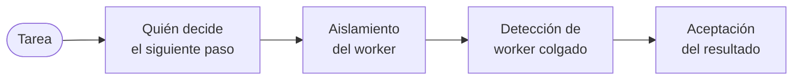
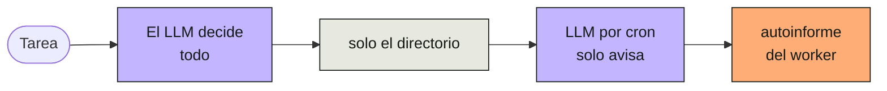
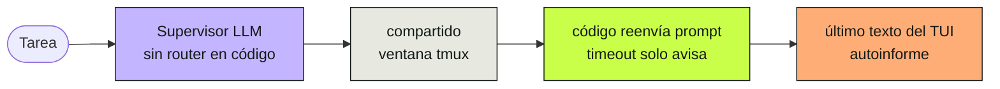
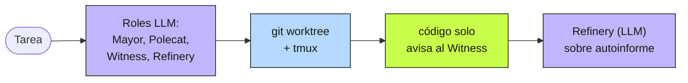
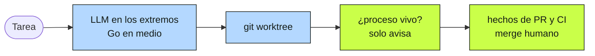
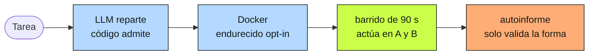
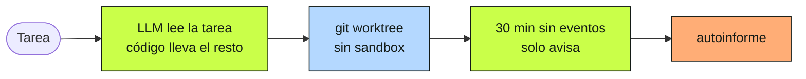
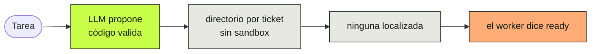
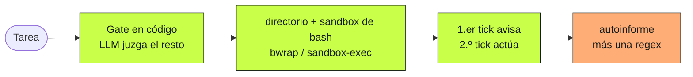
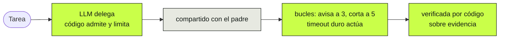

La misma pregunta a nueve orquestadores de código abierto: cuando entra una tarea, **¿quién decide cada paso, el modelo o el código?**

Un diagrama por cada uno. Se lee de izquierda a derecha.

<!--truncate-->

## Leyenda de colores

| Color | Significa |
|---|---|
| 🟩 verde | lo decide o lo hace el **código** |
| 🟪 morado | lo decide el **LLM** |
| 🟦 azul | mixto: LLM y código |
| ⬜ gris | no localizado / compartido |
| 🟧 naranja | **autoinforme**: el worker se corrige a sí mismo |

## El flujo que sigue cada diagrama

## Los nueve

### cc-super-agent

Todo en el prompt. El código solo hace logística.

### cli-agent-orchestrator

Un supervisor LLM, sin router en código.

### gastown

Cuatro roles LLM; el código despacha y avisa.

### agent-orchestrator

LLM en los extremos, Go determinista en medio.

### agent-swarm

El código filtra, admite y reclama; el barrido actúa sobre workers colgados (casos A y B).

### super-super-harness

El código lleva la cola, el worktree y los reintentos.

### dsh-superagent-prototype

Pequeño y limpio. No se localizó detección de worker colgado.

### dsh-super-agent (LofiSu)

Sandbox de bash por worker a nivel de sistema (bwrap / sandbox-exec); el watchdog escala.

### deer-flow

**El código comprueba** el resultado contra evidencia de herramientas, si el lead pasó criterios.

## Lo que se repite

- 🟧 **Siete de nueve aceptan el autoinforme del worker** (gastown añade un revisor LLM encima). Solo deer-flow comprueba evidencia de herramientas en código, y solo si el lead pasó criterios; agent-orchestrator la deriva de hechos de PR y CI.
- **La detección casi siempre solo avisa.** Pocos detectores actúan (agent-swarm casos A y B, el 2.º tick de LofiSu, el timeout de deer-flow).
- **El aislamiento es flojo por defecto.** Un git worktree o un directorio es el techo habitual; solo LofiSu (sandbox del sistema) y agent-swarm (Docker, endurecimiento opt-in) llegan más lejos.

## Explóralos

Cada diagrama es interactivo (zoom, foco, índice de nodos y cada nodo con su fuente `fichero:línea`): **[abrir los nueve diagramas](https://valdepeace.github.io/agentscope/orquestacion.html)**.

## Límites

- La cobertura de lectura es baja (del 0,2 % al 32 % de cada repo). Los diagramas muestran lo leído; «no localizado» significa «no encontrado en lo que leí».
- No se ejecutó nada. Sin benchmarks, sin tiempos, sin costes.
- Las comprobaciones de los diagramas son automáticas (esquema, citas contra el commit fijado, navegador). Ninguno se ha revisado a ojo.

Las puntuaciones, arquitectura frente a lo declarado y la rúbrica están en [el primer post](/es/blog/2026/11/22/nine-code-agent-orchestrators) y en [el estudio completo](https://github.com/valdepeace/agentscope/tree/main/orchestrators).
