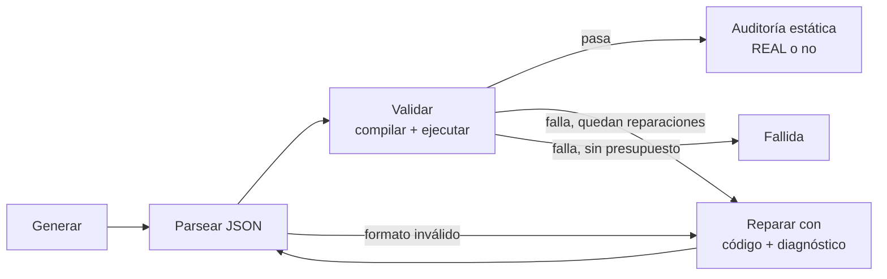

Si un modelo local pequeño escribe un test unitario, el test falla, y le devuelves el error del compilador o del test para que lo intente otra vez, ¿cuánto mejora? Una tesis de máster reciente dice que el bucle ayuda. Lo he replicado en mi máquina para ver cuánto, y lo más útil que he encontrado ha sido un fallo en mi propio prompt.

**Instantánea de investigación:** cinco modelos locales · una RTX 3060 Ti (8 GB) · 10.800 ejecuciones en Java, Python y Node · dos versiones del prompt en Java · cada test aceptado, auditado · cero afirmaciones de benchmark.

<!--truncate-->

import {GainChart, SymbolChart, LanguageChart} from '@site/src/components/VeraCharts';

## Qué mide VERA

VERA es el acrónimo de *Validation · Execution · Repair · Audit*. La referencia es una tesis de máster (UNED, 2026), *Agentic Validate–Repair Workflows for Local Large Language Models: A Controlled Empirical Evaluation on Automated Unit Test Generation*. VERA-01 replica su comparación central:

- **baseline**: el modelo tiene un intento para escribir un test de un método focal.
- **repair**: el mismo primer intento y hasta tres reparaciones, cada una con el código anterior del modelo y el diagnóstico (error de compilación, test que falla o salida mal formada).

Mismo prompt, mismos parámetros, mismo comando de validación. Lo único que cambia es el presupuesto de reparación.

Que pase en verde no basta. Cada test aceptado pasa por una auditoría estática que solo lo cuenta como **REAL** si declara un test, tiene aserciones y llama al método focal. Todo lo que sigue es la tasa REAL.

| Pieza | Qué usé |
|---|---|
| GPU | RTX 3060 Ti, 8 GB |
| Servidor | Ollama 0.40.13, modelos Q4_K_M, `num_ctx` 8192, temperatura 0,7 |
| Modelos | `llama3.1:8b`, `qwen2.5-coder:7b`, `qwen3:8b`, `gemma4:e4b` y, en Java, `ornith-1.5:9b` |
| Java | 20 métodos de Apache Commons Lang, JUnit 5, Maven |
| Python | 20 métodos de pydash, pytest |
| Node | 20 métodos de validator.js, `node --test` |
| Plan | 20 métodos × 15 repeticiones × 2 condiciones por modelo |

## Java: el bucle ayuda a todos los modelos, pero no como en la tesis

Con el primer prompt (`vera01-p1`), repair mejoró a los cinco modelos y ningún intervalo de confianza tocó el cero. La diferencia entre modelos fue enorme:

| Modelo | Baseline | Repair | Mejora (pp, IC 95 %) | Mejora en la tesis |
|---|---:|---:|---|---:|
| `qwen3:8b` | 0,0 % | 74,7 % | +75 [69, 79] | +9,3 |
| `ornith-1.5:9b` | 25,0 % | 64,0 % | +39 [31, 46] | — |
| `qwen2.5-coder:7b` | 32,3 % | 58,7 % | +26 [18, 34] | +20,0 |
| `llama3.1:8b` | 8,3 % | 53,3 % | +45 [38, 51] | +4,6 |
| `gemma4:e4b` | 6,0 % | 18,3 % | +12 [7, 18] | +34,0 |

La dirección coincide con la tesis. El tamaño y el orden, no: gemma4 es el que más mejora en la tesis y el que menos aquí, y qwen3 y llama3.1 hacen justo lo contrario.

## El fallo que inflaba el efecto

Un baseline del 0 % en qwen3 olía raro, así que me puse a leer los fallos. El prompt nunca le decía al modelo en qué paquete estaba la clase bajo prueba. Casi todos los primeros intentos morían con `cannot find symbol`, y la primera reparación arreglaba el import, porque el error del compilador te dice exactamente qué falta.

Contando las reparaciones cuyo primer fallo fue de resolución de símbolos: 97 % en qwen3, 84 % en llama3.1, 71 % en gemma4, 64 % en qwen2.5-coder y 36 % en ornith. En cuatro de los cinco modelos, casi todo lo que le estaba atribuyendo al bucle era el bucle arreglando mi prompt.

<SymbolChart lang="es" />

Los datos de p1 no los toqué. Prerregistré un segundo prompt (`vera01-p2`) que solo añade la línea del import completo, dejé escrito el criterio de éxito antes de ejecutarlo (la mejora debe excluir el cero en al menos tres de los cinco modelos) y lancé otras 3.000 ejecuciones:

| Modelo | Baseline p1 → p2 | Repair p1 → p2 | Mejora p1 → p2 |
|---|---|---|---|
| `gemma4:e4b` | 6 % → 57 % | 18 % → 79 % | +12 → +21 |
| `llama3.1:8b` | 8 % → 51 % | 53 % → 63 % | +45 → +12 |
| `ornith-1.5:9b` | 25 % → 43 % | 64 % → 78 % | +39 → +35 |
| `qwen2.5-coder:7b` | 32 % → 55 % | 59 % → 70 % | +26 → +15 |
| `qwen3:8b` | 0 % → 34 % | 75 % → 42 % | +75 → +8 |

Todos los baselines se disparan. La mejora del bucle baja en cuatro modelos, pero sigue excluyendo el cero en cuatro de cinco (todos menos qwen3), así que el criterio prerregistrado se cumple. El bucle funciona de verdad; solo que mucho menos en cuanto el prompt deja de sabotear el primer intento.

<GainChart lang="es" />

## Python y Node: mejoras más pequeñas y más estables

Los prompts de Python y Node no tienen el problema del import, así que estas ejecuciones (2.400 por lenguaje, prompt p1, los cuatro modelos de la tesis) se acercan más a lo que hace el bucle por sí solo:

| Lenguaje | Modelo | Baseline | Repair | Mejora (pp, IC 95 %) |
|---|---|---:|---:|---|
| Python | `gemma4:e4b` | 28 % | 53 % | +25 [17, 32] |
| Python | `llama3.1:8b` | 32 % | 53 % | +21 [13, 29] |
| Python | `qwen2.5-coder:7b` | 55 % | 68 % | +13 [6, 21] |
| Python | `qwen3:8b` | 50 % | 57 % | +7 [−1, 15] |
| Node | `gemma4:e4b` | 30 % | 58 % | +28 [20, 35] |
| Node | `llama3.1:8b` | 35 % | 47 % | +12 [4, 20] |
| Node | `qwen2.5-coder:7b` | 18 % | 29 % | +11 [5, 18] |
| Node | `qwen3:8b` | 50 % | 65 % | +15 [7, 23] |

<LanguageChart lang="es" />

Siete de las ocho celdas mejoran con un intervalo que excluye el cero, y las mejoras (de +7 a +28 puntos) se parecen a Java con p2, no a Java con p1. Una señal de alarma: gemma4 en Node genera tests vacíos en el 10 % de sus ejecuciones, y por eso su tasa en bruto con reparación (65 %) queda siete puntos por encima de la REAL.

## Dos fallos del arnés, cazados por los datos

Dos veces, ejecuciones que el arnés archivaba como fallos de infraestructura resultaron ser otra cosa:

- **Sustitutos UTF-16 sueltos.** Cuando un modelo escribía un escape de JavaScript como `\ud800` sin duplicar la barra, `json.loads` producía un sustituto suelto que no se podía escribir en UTF-8. Así se perdieron 36 ejecuciones de Node, 35 de ellas en `isSurrogatePair`, de modo que la exclusión no tenía nada de aleatoria. Ahora el parser devuelve el escape a su forma textual.
- **Un «HTTP 500» que no era del servidor.** Las cinco últimas ejecuciones inválidas fallaban con un 500. El motor tiraba el cuerpo del error; cuando lo leí, decía `prediction aborted, token repeat limit reached`: Ollama corta la generación cuando el modelo entra en bucle con los mismos tokens. Eso es un fallo del modelo, como quedarse sin `num_predict`, así que ahora cuenta como salida truncada.

En los dos casos arreglé el arnés, guardé copia de los registros inválidos y repetí solo esas ejecuciones, sin tocar las válidas. Python y Node quedan con 2.400 de 2.400 ejecuciones válidas cada uno. No cambió ninguna conclusión, pero excluir esas ejecuciones habría sesgado las tasas a favor del éxito.

## Entonces, ¿la conclusión es la misma que la de la tesis?

Sí, en lo que importa: un bucle de validación y reparación hace que los modelos locales pequeños escriban más tests que prueban algo de verdad, en todos los modelos que he probado y en los tres lenguajes. La gracia está en los detalles.

- **Con mi primer prompt no se parecía en nada a la tesis.** Mejoras de hasta +75 puntos y el orden de los modelos patas arriba. Eso era el hueco del import, no el bucle.
- **Con el prompt justo, sí se parece.** En p2 las mejoras (de +8 a +35 puntos) caen en el mismo rango que las de la tesis (de +5 a +34), y el orden es casi el mismo: gemma4 es el que más mejora y qwen2.5-coder el segundo en las dos; llama3.1 y qwen3 son los que menos, solo que intercambiados.
- **Las tasas absolutas no se replican.** Mis baselines de p2 (34–57 %) quedan muy por encima de los de la tesis (18–43 %). La mitad de los 20 métodos los elegí yo, porque la tesis no los publica, y los prompts son reconstrucciones, así que solo compararía mejoras, no niveles.
- **Python y Node lo amplían.** La tesis solo cubre Java. El bucle también ayuda ahí (de +7 a +28 puntos), con un efecto del mismo tamaño que en Java con el prompt justo.

La lección más útil va menos del bucle y más de cómo medirlo: un bucle de reparación esconde muy bien un prompt roto. Si el primer intento falla por algo que el mensaje de error explica con pelos y señales, el bucle parecerá brillante.

## Antes de citar nada de esto

- **REAL es una auditoría estática.** Comprueba que hay un test, aserciones y una llamada al método focal. No ejecuta mutantes, así que una aserción vacía puede colarse.
- **Los intervalos son optimistas.** Los de Newcombe tratan las ejecuciones como independientes, pero comparten método focal, modelo y comando de validación.
- **Una máquina, un tamaño de contexto, prompts reconstruidos.** Los prompts de la tesis no están publicados literalmente; los míos son reconstrucciones, y p1 tenía el hueco del import que he contado arriba.

## Lo siguiente

El código, los planes, los informes y la explicación completa de cada desviación están en [vera-replication](https://github.com/valdepeace/vera-replication) (MIT). El siguiente paso es VERA-02: llevar el mismo bucle a un subconjunto fijo de tareas de Python y JavaScript de DeepSWE, dejando el verificador oficial fuera del bucle de reparación y usándolo solo para puntuar las dos ramas al final.
